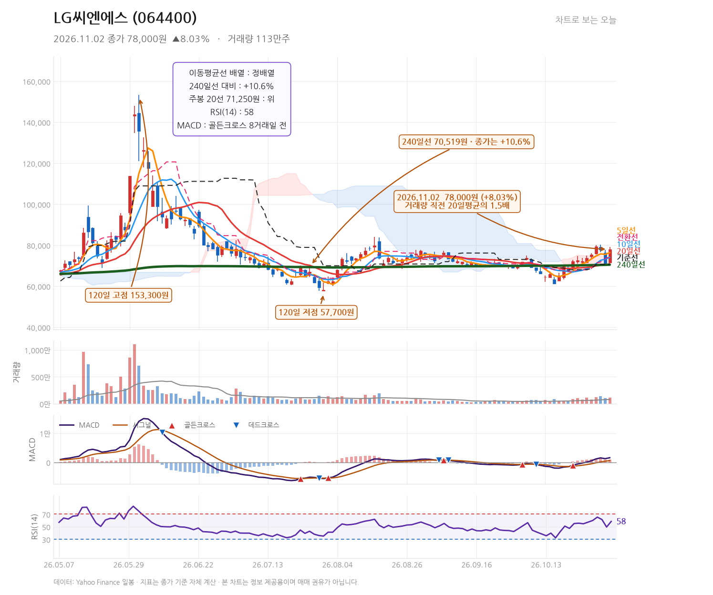

# 발행 지시서 — 2026-11-02 (묶음 글 1편)
작성: DeepSeek API · 발행: 클로드

## 공통 정보
- 블로그: https://mynote86824.tistory.com
- 카테고리: 오늘의 핫종목
- 발행 방식: **비공개** (형 확인 후 공개 전환)
- 형식: **하루 1편 묶음 글** — 종목 1개를 한 글에서 다룸
- 다룬 종목: LG씨엔에스(064400)
- 발행 전 검증: 아래 「검증용 수치」를 Daum API 값과 대조, 금지 문체 확인

## 검증용 수치 (원고 작성에 사용한 값)
| 종목 | 코드 | 종가 | 등락률 | 고가 | 저가 | 거래량 |
|---|---|---|---|---|---|---|
| LG씨엔에스 | 064400 | 78,000 | +8.03% | 79,200 | 71,400 | 1,125,592 |

---

## 제목
LG씨엔에스 78,000원 +8.03%, 거래량 1.5배·240일선 10.6% 위 (2026.11.2)

## 태그
#LG씨엔에스 #064400 #LG CNS #주가분석 #차트분석

## 본문 HTML

<b>2026년 11월 2일 LG씨엔에스(064400)는 시가 71,500원에서 출발해 종가 78,000원(+8.03%)으로 마감했습니다. 거래량은 1,125,592주로 직전 20거래일 평균의 1.5배였고, 종가는 240일선(70,519원)을 10.6% 웃돌았습니다.</b>

<h2>출발가 71,500원에서 저가 71,400원, 그리고 79,200원까지</h2>

이날 LG씨엔에스의 하루 범위는 저가 71,400원에서 고가 79,200원까지였습니다. 시가 71,500원이 사실상 저가와 거의 같았고, 장중 위쪽으로 7,800원(약 10.9%) 폭의 캔들이 만들어졌습니다. 종가 78,000원은 고가 79,200원에서 1,200원(약 1.5%) 아래로, 윗꼬리가 그리 길지 않은 몸통 중심의 양봉입니다.

전일 종가 72,200원과 비교하면 종가 기준 +5,800원이며, 시가 대비로는 +6,500원입니다. 시가가 전일 종가보다 700원 낮게 형성된 뒤 매수세가 붙어 종가를 끌어올린 흐름으로 읽힙니다.

<h2>이동평균선 위로 올라선 자리, 지표는 무엇을 말하나</h2>

종가 78,000원은 5일선(76,400원)과 10일선(74,060원), 20일선(70,815원), 240일선(70,519원)을 모두 위에 두고 있습니다. 배열은 정배열이며, 240일선 대비로는 +10.6%입니다. 주봉 20선은 71,250원으로, 일봉의 중장기선과 비슷한 위치에 모여 있습니다.

<table style="border-collapse:collapse;width:100%;" border="1">
<tbody>
<tr><td><b>지표</b></td><td><b>값</b></td><td><b>해석</b></td></tr>
<tr><td>5일선</td><td>76,400원</td><td>종가가 5일선 위, 단기 추세 유지</td></tr>
<tr><td>20일선</td><td>70,815원</td><td>240일선(70,519원)과 근접해 지지 구간이 겹침</td></tr>
<tr><td>MACD</td><td>1,589.1 / 시그널 628.8</td><td>8거래일 전 골든크로스, 히스토그램 960.3으로 확대</td></tr>
<tr><td>RSI(14)</td><td>58.5</td><td>과열권(70) 아래, 상승 여력 남은 구간</td></tr>
<tr><td>일목 전환선 / 기준선</td><td>74,300원 / 70,700원</td><td>종가가 둘 다 위, 전환선이 기준선 위</td></tr>
</tbody>
</table>

MACD가 8거래일 전 골든크로스 이후 히스토그램을 키우고 있다는 점, RSI가 58.5로 아직 과열 구간에 들어서지 않았다는 점이 이날 캔들과 함께 놓이는 지점입니다.

<h2>52주 고점 대비 -49.1%, 위쪽은 비어 있는 구간</h2>

120일 고점은 153,300원, 저점은 57,700원입니다. 52주 고점 153,300원, 저점 54,100원이며 현재가는 52주 고점 대비 -49.1% 수준입니다. 즉 지금 가격은 52주 범위의 중간보다 아래에 있고, 위로는 120일 고점까지 약 2배 가까운 거리가 남아 있습니다. 반대로 아래로는 20일선·240일선이 70,500~70,800원대에 몰려 있어 이 구간이 단기 방어선 역할을 하는 모양새입니다.

저항으로 볼 만한 가격대는 이날 고가 79,200원과 120일 고점 153,300원 사이에서 형성될 것이나, 데이터상 그 사이에 확인된 뚜렷한 매물대 수치는 제시된 값이 없어 특정 가격을 단정하지 않습니다. 지지 쪽은 5일선 76,400원, 그 아래 20일선·240일선이 겹치는 70,500~70,800원대, 그리고 이날 저가 71,400원입니다.

<h2>인도네시아 AIDC 완공 소식과 피지컬 AI 구상</h2>

이날 보도에서 눈에 띄는 것은 인도네시아 AIDC( AI 데이터센터) 완공 소식입니다. LG CNS가 아시아태평양 인프라 시장을 겨냥한다는 내용으로, 데이터센터 구축·운영 사업의 해외 확장을 보여주는 대목입니다. (<a href="https://n.news.naver.com/mnews/article/014/0005598236" target="_blank">파이낸셜뉴스</a>)

함께 실린 인터뷰에서는 제조 현장 데이터를 모아 피지컬 AI를 고도화하고 그 선순환을 만들겠다는 방향이 언급됐습니다. (<a href="https://n.news.naver.com/mnews/article/014/0005598274" target="_blank">파이낸셜뉴스</a>) 두 보도 모두 사업 방향에 대한 내용이며, 이날 주가 상승과의 직접적 인과관계를 수치로 확인할 수는 없습니다. 거래량이 평균 1.5배로 늘어난 사실은 확인되지만, 그것이 특정 기사 하나 때문이라고 단정하지 않습니다.

<h2>이 종목이 보여주는 것 — 시가 부근에서 시작된 하루</h2>

이날 캔들에서 읽을 수 있는 것은 시가 71,500원이 저가 71,400원과 거의 같았다는 점입니다. 장 초반의 가격대가 그날의 바닥이 되고, 이후 종가까지 6,500원이 올라간 구조입니다. 이런 날은 추격보다 시가 부근에서 형성된 가격대가 이후 조정에서 지지로 작동하는지를 보는 편이 낫습니다. 240일선 위에 있다는 사실 자체는 중장기 위치를 알려주지만, 52주 고점 대비 -49.1%라는 수치가 말해주듯 회복의 폭은 아직 멀리 남아 있습니다.

<h2>다음에 볼 가격대</h2>

위쪽에서는 이날 고가 79,200원을 종가로 넘기는지가 첫 관문입니다. 넘긴다면 5일선 76,400원이 지지로 바뀌는 흐름이 이어지는지 확인할 지점이고, 그 아래로 밀릴 경우 20일선 70,815원과 240일선 70,519원이 겹치는 70,500~70,800원대가 두 번째 방어선입니다. 이 구간을 종가로 이탈하면 이날 양봉의 추세 해석은 무효가 됩니다. RSI 58.5가 70을 넘어서는지도 함께 볼 만하나, 과열 진입 자체가 매도 신호는 아닙니다.

이날 다룬 종목은 LG씨엔에스 한 곳입니다. 다른 종목과의 비교나 공통 원인 해석은 데이터에 없으므로 넣지 않았습니다.

※ 본 글은 기업 및 주가에 대한 정보와 분석을 제공하기 위한 목적으로 작성되었으며, 특정 금융투자상품의 매수·매도 또는 투자를 권유하지 않습니다. 
※ 본문에 포함된 실적 전망, 목표주가, 예상 EPS 등 미래 관련 수치는 시장 컨센서스 또는 전망치이며 확정된 결과가 아닙니다. 
※ 차트의 주요 가격대와 기술적 분석은 작성 시점의 데이터를 기준으로 한 분석 의견이며, 향후 주가 움직임을 보장하지 않습니다. 
※ 투자 판단은 각 투자자의 독립적인 판단과 책임에 따라 이루어져야 합니다. 
※ 작성자는 해당 종목을 보유하지 않고 있으며, 본 글은 이해관계와 무관하게 작성되었습니다.

▶ <a href="https://mynote86824.tistory.com/pages/누적-수익률" target="_blank">누적 수익률 전체 보기</a>

