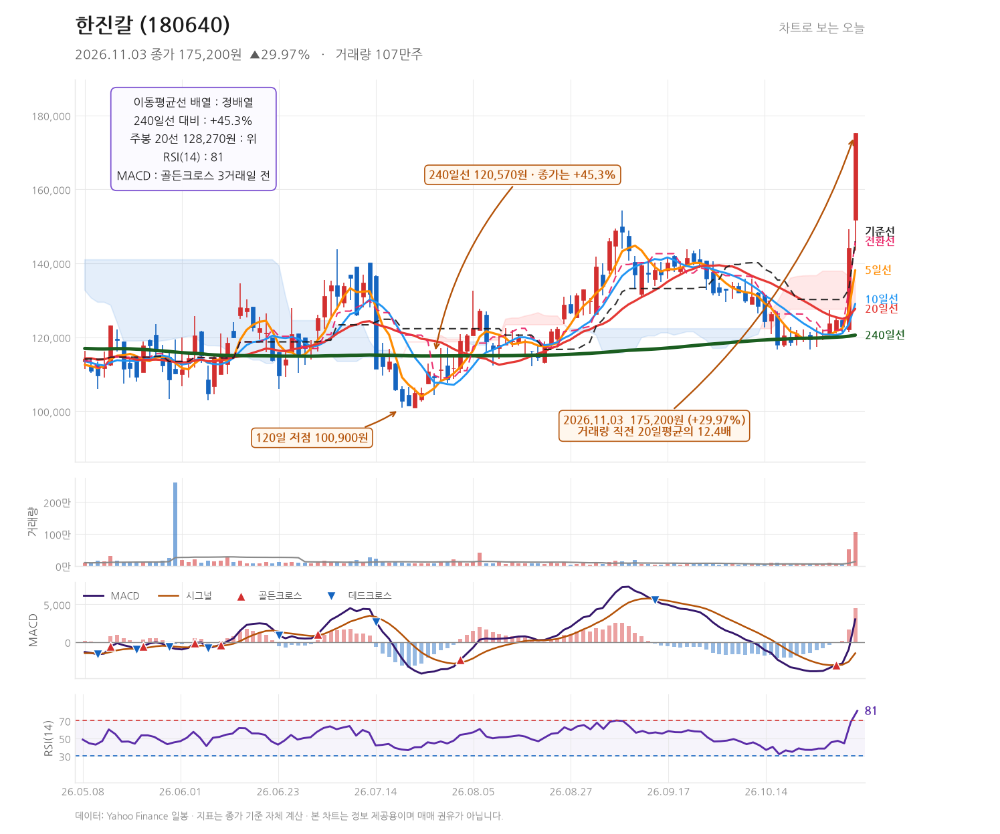
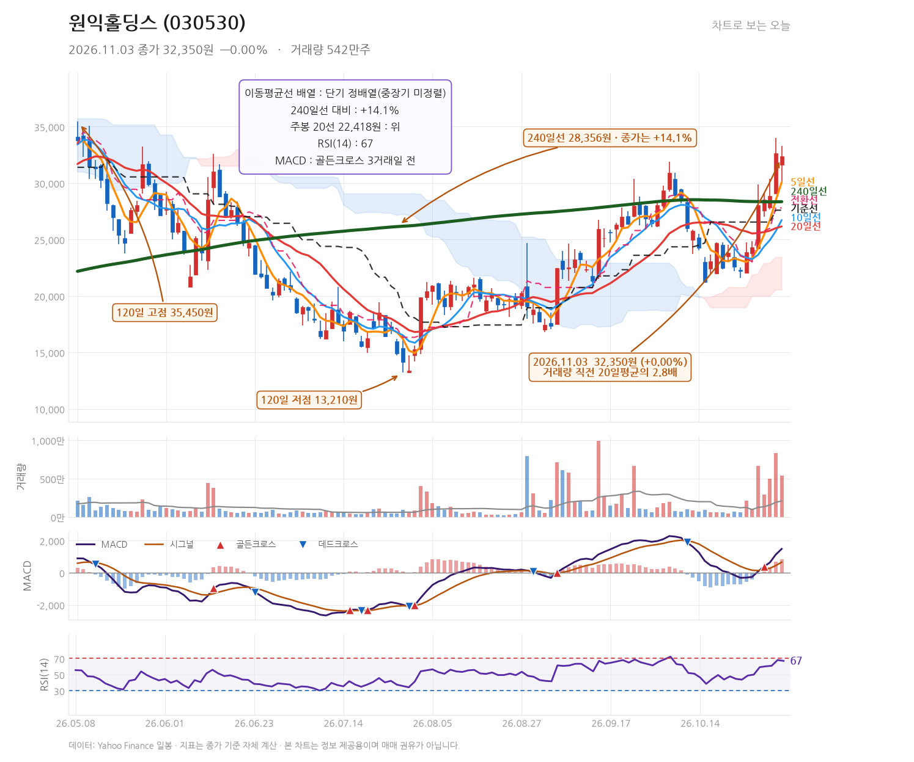

# 발행 지시서 — 2026-11-03 (묶음 글 1편)
작성: DeepSeek API · 발행: 클로드

## 공통 정보
- 블로그: https://mynote86824.tistory.com
- 카테고리: 오늘의 핫종목
- 발행 방식: **비공개** (형 확인 후 공개 전환)
- 형식: **하루 1편 묶음 글** — 종목 2개를 한 글에서 다룸
- 다룬 종목: 한진칼(180640), 원익홀딩스(030530)
- 발행 전 검증: 아래 「검증용 수치」를 Daum API 값과 대조, 금지 문체 확인

## 검증용 수치 (원고 작성에 사용한 값)
| 종목 | 코드 | 종가 | 등락률 | 고가 | 저가 | 거래량 |
|---|---|---|---|---|---|---|
| 한진칼 | 180640 | 175,200 | +29.97% | 175,200 | 143,500 | 1,071,318 |
| 원익홀딩스 | 030530 | 32,350 | +0.00% | 33,300 | 30,000 | 5,440,665 |

---

## 제목
한진칼 상한가 +29.97%·원익홀딩스 보합, 11월 3일 두 종목 차트 점검

## 태그
#한진칼 #원익홀딩스 #상한가 #거래량급증 #차트분석

## 본문 HTML

<b>2026년 11월 3일 한진칼(180640)은 종가 175,200원으로 전일 대비 +29.97% 상한가를 기록했고 거래량은 직전 20거래일 평균의 12.4배였습니다. 같은 날 원익홀딩스(030530)는 종가 32,350원으로 보합(+0.00%)을 나타냈으며 거래량은 평균의 2.8배였습니다.</b>

<h2>한진칼, 하루 만에 30% 급등한 차트에서 무엇을 봐야 하나</h2>

한진칼은 시가 151,700원에서 출발해 저가 143,500원까지 밀렸다가 종가 175,200원에 마감했습니다. 고가와 종가가 같은 175,200원으로, 장 마감까지 상한가를 유지한 하루였습니다. 전일 종가 134,800원과 비교하면 하루 만에 4만 원 넘게 뛴 셈입니다.

거래량은 1,071,318주로 직전 20거래일 평균의 12.4배입니다. 가격 상승과 거래량 폭증이 동시에 나타난 전형적인 돌파 캔들이며, 120일 고점(175,200원)을 당일 종가로 경신했습니다. 52주 고점 175,900원과의 거리는 -0.4%에 불과합니다.

<h3>이동평균선과 보조지표는 어떤 상태인가</h3>
<table style="border-collapse:collapse;width:100%;" border="1">
<tbody>
<tr><td><b>지표</b></td><td><b>값</b></td><td><b>해석</b></td></tr>
<tr><td>MA5</td><td>138,140원</td><td>종가가 5일선을 크게 상회</td></tr>
<tr><td>MA20</td><td>127,680원</td><td>단기선 정배열 유지</td></tr>
<tr><td>MA240</td><td>120,570원</td><td>종가가 240일선 대비 +45.3%</td></tr>
<tr><td>MACD</td><td>3,008.8 / 시그널 -1,484.7</td><td>3거래일 전 골든크로스, 히스토그램 4,493.6</td></tr>
<tr><td>RSI(14)</td><td>81.2</td><td>과매수 구간 진입</td></tr>
<tr><td>일목 전환선·기준선</td><td>145,900원 / 145,900원</td><td>두 선 모두 종가 아래</td></tr>
</tbody>
</table>

이평선은 5·10·20·240일선이 모두 정배열을 이루고 있습니다. MACD는 3거래일 전 골든크로스가 발생한 뒤 히스토그램이 4,493.6까지 확대됐습니다. 다만 RSI가 81.2로 과매수 영역에 들어와 있어, 단기적으로 속도 조절이 나올 수 있는 자리입니다.

<h3>급등의 배경에 있는 뉴스는 무엇인가</h3>

이날 상승에는 경영권 지분 경쟁 관련 보도가 맞물렸습니다. 국제신문은 조원태 회장의 추가 매수와 호반과의 지분 경쟁 2라운드를 전했습니다(<a href="https://n.news.naver.com/mnews/article/658/0000160296" target="_blank">기사</a>). 한겨레는 급락장에서 한진칼이 상한가를 기록하며 호반의 다음 행보에 관심이 쏠린다고 보도했습니다(<a href="https://n.news.naver.com/mnews/article/028/0002830547" target="_blank">기사</a>). 헤럴드경제는 하루 만에 30% 급등하며 우선주까지 상한가를 기록한 흐름을 다뤘습니다(<a href="https://n.news.naver.com/mnews/article/016/0002718340" target="_blank">기사</a>).

<h3>한진칼의 다음 관전 구간은 어디인가</h3>

1차 기준선은 당일 시가이자 저가 부근인 143,500~151,700원대입니다. 상한가 이후 조정이 나올 경우 이 구간이 지지 여부를 가늠하는 첫 번째 가격대가 됩니다. 상방에서는 52주 고점 175,900원이 바로 위에 있어, 이 가격을 종가로 넘겨서 유지하는지가 추세 연장의 확인 지점입니다. 반대로 종가가 145,900원(일목 전환선·기준선) 아래로 내려오면 이번 돌파 흐름은 무효화된 것으로 봐야 합니다.

<h2>원익홀딩스, 거래량은 2.8배인데 종가는 제자리였던 이유</h2>

원익홀딩스는 시가 31,600원에서 출발해 고가 33,300원까지 올랐지만 종가 32,350원으로 전일 종가와 정확히 같은 가격에 마감했습니다. 등락률 0.00%입니다. 장중 저가는 30,000원으로, 하루 변동 폭이 3,300원에 달했음에도 종가 기준으로는 변화가 없었던 하루입니다.

거래량은 5,440,665주로 직전 20거래일 평균의 2.8배였습니다. 가격은 보합인데 거래량이 평균의 세 배 가까이 늘었다는 것은, 그 가격대에서 매수와 매도가 활발히 맞섰다는 뜻으로 읽을 수 있습니다.

<h3>이평선 배열과 지표는 어떻게 놓여 있나</h3>

5일선 30,090원, 10일선 26,730원, 20일선 26,162원으로 단기선은 정배열입니다. 다만 240일선이 28,356원으로, 종가는 이보다 +14.1% 위에 있습니다. 52주 고점 50,600원과 비교하면 -36.1%로 아직 고점 대비 낮은 위치입니다. MACD는 3거래일 전 골든크로스를 냈고 히스토그램이 829.4로 확대됐으며, RSI는 67.0으로 과매수 직전 수준입니다. 일목 전환선 27,800원과 기준선 27,600원 모두 종가 아래에 있습니다.

<h3>뉴스에서 확인되는 것은 무엇인가</h3>

한국경제는 반도체 호황을 배경으로 원익 공채에 1만 2,000명이 몰려 역대 최대 규모를 기록했다고 보도했습니다(<a href="https://n.news.naver.com/mnews/article/015/0005349700" target="_blank">기사</a>). 같은 날 서울경제는 하락한 삼성전자를 담는 초고수 동향을, 한국경제TV는 외국인·기관 동반 매도 속 개인의 매수세를 각각 전했습니다(<a href="https://n.news.naver.com/mnews/article/011/0004678172" target="_blank">기사</a>, <a href="https://n.news.naver.com/mnews/article/215/0001271459" target="_blank">기사</a>).

<h3>원익홀딩스가 방향을 정하려면 어떤 가격이 필요하나</h3>

당일 고가 33,300원이 단기 저항선입니다. 이 가격을 종가로 넘기면 보합에서 벗어나 상승 방향이 확인됩니다. 아래쪽에서는 30,000원(당일 저가)과 30,090원(5일선)이 겹치는 구간이 1차 지지선입니다. 종가가 27,600~27,800원(일목 기준선·전환선) 아래로 내려오면 단기 정배열 흐름이 흔들리는 것으로 판단할 수 있습니다.

<h2>종목별 다음 관전 포인트</h2>

한진칼과 원익홀딩스는 업종과 사업 영역이 겹치지 않고, 이날 상승·보합의 원인도 지분 경쟁 보도와 반도체 업황 관련 보도로 서로 다릅니다. 두 종목을 하나의 흐름으로 묶어 볼 근거는 없으며, 각각의 가격대만 따로 보는 것이 맞습니다.

한진칼은 175,900원(52주 고점)을 종가로 넘겨 유지하는지, 조정 시 143,500~151,700원대가 지지되는지를 봅니다. 145,900원 아래로 종가가 내려오면 이번 돌파는 무효로 봅니다. 원익홀딩스는 33,300원 돌파 여부와 30,000원 부근 지지력을 확인하고, 27,600~27,800원 이탈 여부를 추세 훼손 기준으로 삼습니다.

※ 본 글은 기업 및 주가에 대한 정보와 분석을 제공하기 위한 목적으로 작성되었으며, 특정 금융투자상품의 매수·매도 또는 투자를 권유하지 않습니다. 
※ 본문에 포함된 실적 전망, 목표주가, 예상 EPS 등 미래 관련 수치는 시장 컨센서스 또는 전망치이며 확정된 결과가 아닙니다. 
※ 차트의 주요 가격대와 기술적 분석은 작성 시점의 데이터를 기준으로 한 분석 의견이며, 향후 주가 움직임을 보장하지 않습니다. 
※ 투자 판단은 각 투자자의 독립적인 판단과 책임에 따라 이루어져야 합니다. 
※ 작성자는 해당 종목을 보유하지 않고 있으며, 본 글은 이해관계와 무관하게 작성되었습니다.

▶ <a href="https://mynote86824.tistory.com/pages/누적-수익률" target="_blank">누적 수익률 전체 보기</a>

