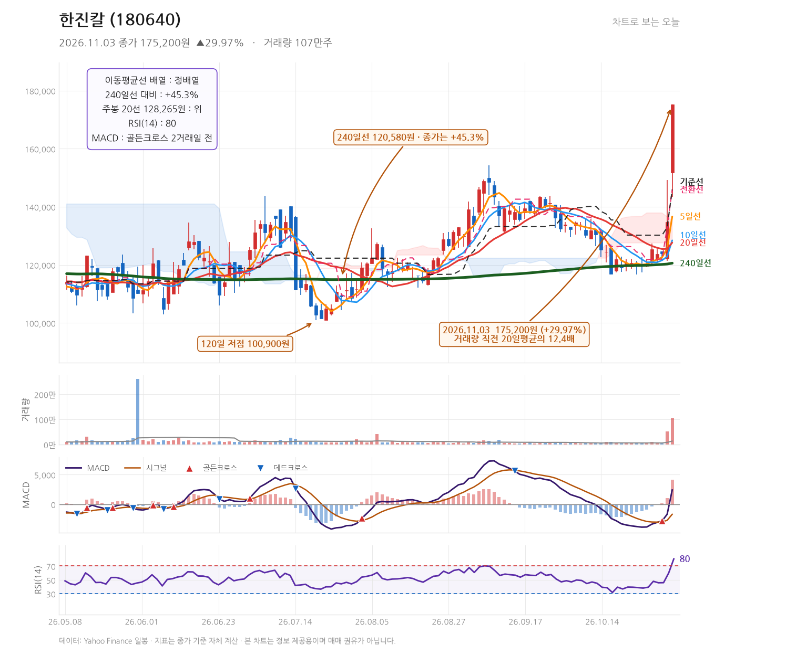
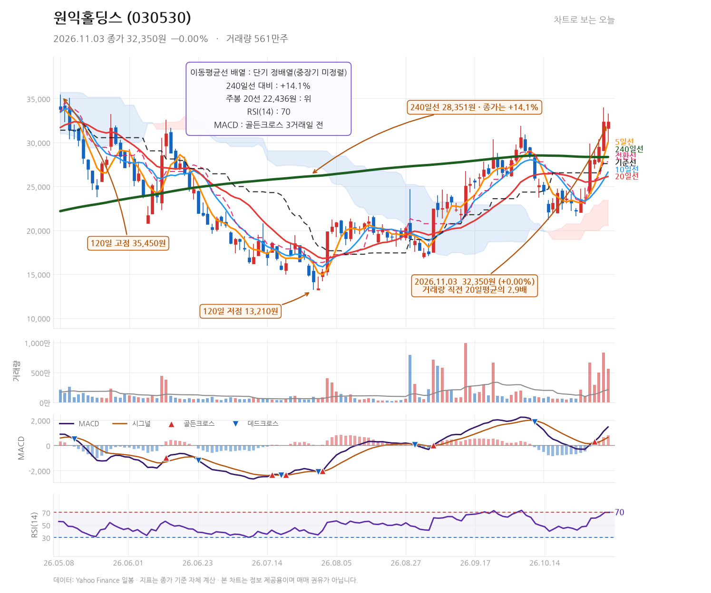

# 발행 지시서 — 2026-11-03 (묶음 글 1편)
작성: DeepSeek API · 발행: 클로드

## 공통 정보
- 블로그: https://mynote86824.tistory.com
- 카테고리: 오늘의 핫종목
- 발행 방식: **비공개** (형 확인 후 공개 전환)
- 형식: **하루 1편 묶음 글** — 종목 2개를 한 글에서 다룸
- 다룬 종목: 한진칼(180640), 원익홀딩스(030530)
- 발행 전 검증: 아래 「검증용 수치」를 Daum API 값과 대조, 금지 문체 확인

## 검증용 수치 (원고 작성에 사용한 값)
| 종목 | 코드 | 종가 | 등락률 | 고가 | 저가 | 거래량 |
|---|---|---|---|---|---|---|
| 한진칼 | 180640 | 175,200 | +29.97% | 175,200 | 143,500 | 1,071,351 |
| 원익홀딩스 | 030530 | 32,350 | +0.00% | 33,300 | 30,000 | 5,603,915 |

---

## 제목
한진칼 29.97% 급등 52주 고점 턱밑, 원익홀딩스 보합 속 거래량 2.9배

## 태그
#한진칼 #원익홀딩스 #차트분석 #지분경쟁 #거래량급증

## 본문 HTML

<b>2026년 11월 3일, 한진칼(180640)은 전일 대비 29.97% 오른 175,200원에 마감하며 52주 고점(175,900원)에 0.4% 차이로 다가섰고 거래량은 직전 20거래일 평균의 12.4배였습니다. 원익홀딩스(030530)는 32,350원으로 보합(0.00%)을 기록했으나 거래량이 평균의 2.9배였습니다.</b>

<h3>한진칼, 하루 만에 52주 고점 코앞까지</h3>

한진칼은 이날 151,700원에 출발해 장중 143,500원까지 밀렸다가 175,200원까지 치솟으며 상한가에 가까운 상승률로 마감했습니다. 종가 175,200원은 120일 고점이자 이날 고가와 같은 값입니다. 52주 고점 175,900원과는 700원 차이입니다.

거래량은 1,071,351주로 직전 20거래일 평균의 12.4배입니다. 가격 상승과 거래량 급증이 같은 날 겹쳤다는 점이 이날 차트의 가장 두드러진 특징입니다.

<h3>한진칼의 이동평균선과 보조지표는 무엇을 말하나</h3>
<table style="border-collapse:collapse;width:100%;" border="1">
<tbody>
<tr><td><b>지표</b></td><td><b>값</b></td><td><b>해석</b></td></tr>
<tr><td>MA5</td><td>136,620원</td><td>종가가 5일선을 28%가량 웃돌아 단기 과열권</td></tr>
<tr><td>MA20</td><td>127,655원</td><td>20일선과의 격차가 37%를 넘어 이격 부담</td></tr>
<tr><td>MA240</td><td>120,580원</td><td>240일선 대비 +45.3%, 장기 추세는 상승</td></tr>
<tr><td>MACD</td><td>2,406.9 / 시그널 -1,697.6</td><td>2거래일 전 골든크로스, 히스토그램 4,104.5로 확장</td></tr>
<tr><td>RSI(14)</td><td>80.3</td><td>70을 넘어 과매수 구간 진입</td></tr>
<tr><td>일목 전환선·기준선</td><td>145,900원 / 145,900원</td><td>두 선이 같은 값으로, 종가는 이 위에 위치</td></tr>
</tbody>
</table>

이평선은 5·10·20·240일선이 모두 정배열을 이루고 있습니다. 다만 RSI가 80.3까지 올라 단기 과열 신호가 함께 켜졌습니다.

<h3>한진칼 급등 배경에 놓인 뉴스</h3>

이날 상승과 관련해 보도된 내용은 지분 경쟁입니다. 조원태 회장이 사재를 털어 대한항공 지분을 추가 매입하고 있다는 소식과, 호반과의 지분 경쟁이 2라운드로 접어들었다는 보도가 나왔습니다. (<a href="https://n.news.naver.com/mnews/article/449/0000366303" target="_blank">채널A</a>, <a href="https://n.news.naver.com/mnews/article/057/0001976565" target="_blank">MBN</a>, <a href="https://n.news.naver.com/mnews/article/658/0000160296" target="_blank">국제신문</a>)

지분 경쟁은 매수 주체가 특정되어 있다는 점에서 일반 수급과 성격이 다릅니다. 다만 어느 시점에 어느 규모로 매수가 이어질지는 보도만으로 확정할 수 없습니다.

<h3>한진칼, 추세가 흔들리는 가격 조건</h3>

이날 종가가 120일 고점과 같은 값이라는 점은 다음 거래일의 기준선이 명확하다는 뜻입니다. 175,900원의 52주 고점을 넘어서면 신고가 국면으로 진입하고, 반대로 이날 상승분을 되돌려 145,900원(전환선·기준선) 아래로 내려오면 이번 급등의 힘이 약해졌다고 볼 수 있습니다. 5일선 136,620원은 단기 추세의 마지막 방어선에 해당합니다.

<h3>원익홀딩스, 등락률 0%인데 거래량은 2.9배</h3>

원익홀딩스는 31,600원에 출발해 33,300원까지 올랐다가 30,000원까지 밀린 뒤 결국 전일 종가와 같은 32,350원에 마감했습니다. 등락률은 0.00%입니다. 가격은 제자리였지만 거래량은 5,603,915주로 직전 20거래일 평균의 2.9배였습니다. 장중 변동 폭이 30,000원에서 33,300원까지 10%를 넘었다는 점을 함께 봐야 합니다.

원익홀딩스는 반도체·디스플레이 장비와 소재 사업을 거느린 지주회사입니다. 이날 관련 보도로는 반도체 호황을 배경으로 원익 공채에 1만 2,000명이 몰려 역대 최대 규모를 기록했다는 소식이 있었습니다. (<a href="https://n.news.naver.com/mnews/article/015/0005349700" target="_blank">한국경제</a>) 채용 규모는 회사의 확장 의지를 보여주는 지표이지만, 당장의 실적으로 직결되는 숫자는 아닙니다.

<h3>원익홀딩스 차트에서 확인되는 위치</h3>

5일선 30,050원, 10일선 26,645원, 20일선 26,135원으로 단기 이평선은 정배열입니다. 240일선 28,351원 대비로는 +14.1% 위에 있습니다. MACD는 3거래일 전 골든크로스를 냈고 히스토그램이 826.0으로 확장 중이며, RSI는 70.2로 과매수 경계선에 걸쳐 있습니다.

120일 고점은 35,450원, 52주 고점은 50,600원입니다. 현재가는 52주 고점 대비 36.1% 아래에 있습니다. 일목 전환선 27,800원과 기준선 27,600원은 모두 현재가 아래에 있어 단기 흐름은 위쪽을 향해 있습니다.

<h3>원익홀딩스에서 다음에 볼 두 가격</h3>

이날 고가 33,300원은 장중 매수세가 도달한 지점입니다. 이 가격을 종가 기준으로 넘어서면 120일 고점 35,450원이 다음 저항으로 등장합니다. 반대로 이날 저가 30,000원과 5일선 30,050원이 거의 겹치는 구간이므로, 이 선이 무너지면 단기 정배열이 흔들리기 시작한다고 볼 수 있습니다.

<h3>종목별 다음 관전 포인트</h3>

<b>한진칼</b>은 175,900원(52주 고점) 돌파 여부와 145,900원(일목 전환선·기준선) 이탈 여부를 함께 봐야 합니다. RSI 80.3은 단기 과열을 뜻하므로, 급등 다음 날 되돌림이 나오는지가 관건입니다.

<b>원익홀딩스</b>는 33,300원(당일 고가)과 30,000원(당일 저가·5일선 부근) 사이에서 방향이 갈릴 수 있습니다. 거래량이 2.9배로 늘었는데 종가가 제자리였다는 점은 매수와 매도가 팽팽히 맞섰다는 의미이므로, 다음 거래일의 종가 방향이 더 중요합니다.

두 종목은 한진칼이 항공·지주 부문, 원익홀딩스가 반도체·디스플레이 장비 부문으로 업종과 사업 영역이 겹치지 않습니다. 같은 날 거래량이 늘었다는 사실 외에 하나의 흐름으로 묶어 볼 근거는 없으며, 각각의 재료와 차트를 따로 보셔야 합니다.

※ 본 글은 기업 및 주가에 대한 정보와 분석을 제공하기 위한 목적으로 작성되었으며, 특정 금융투자상품의 매수·매도 또는 투자를 권유하지 않습니다. 
※ 본문에 포함된 실적 전망, 목표주가, 예상 EPS 등 미래 관련 수치는 시장 컨센서스 또는 전망치이며 확정된 결과가 아닙니다. 
※ 차트의 주요 가격대와 기술적 분석은 작성 시점의 데이터를 기준으로 한 분석 의견이며, 향후 주가 움직임을 보장하지 않습니다. 
※ 투자 판단은 각 투자자의 독립적인 판단과 책임에 따라 이루어져야 합니다. 
※ 작성자는 해당 종목을 보유하지 않고 있으며, 본 글은 이해관계와 무관하게 작성되었습니다.

▶ <a href="https://mynote86824.tistory.com/pages/누적-수익률" target="_blank">누적 수익률 전체 보기</a>

