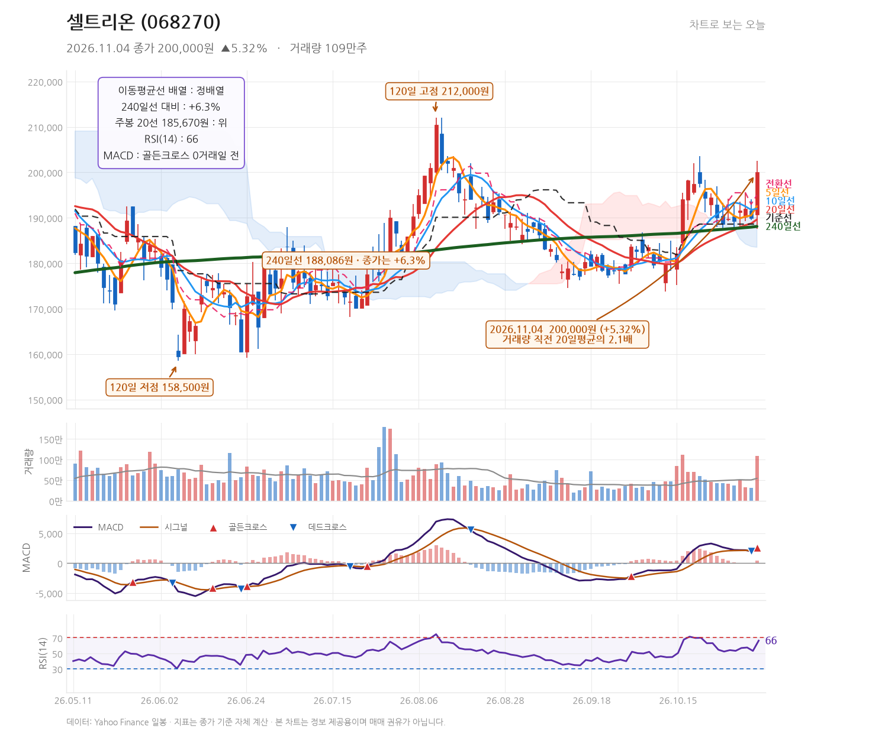
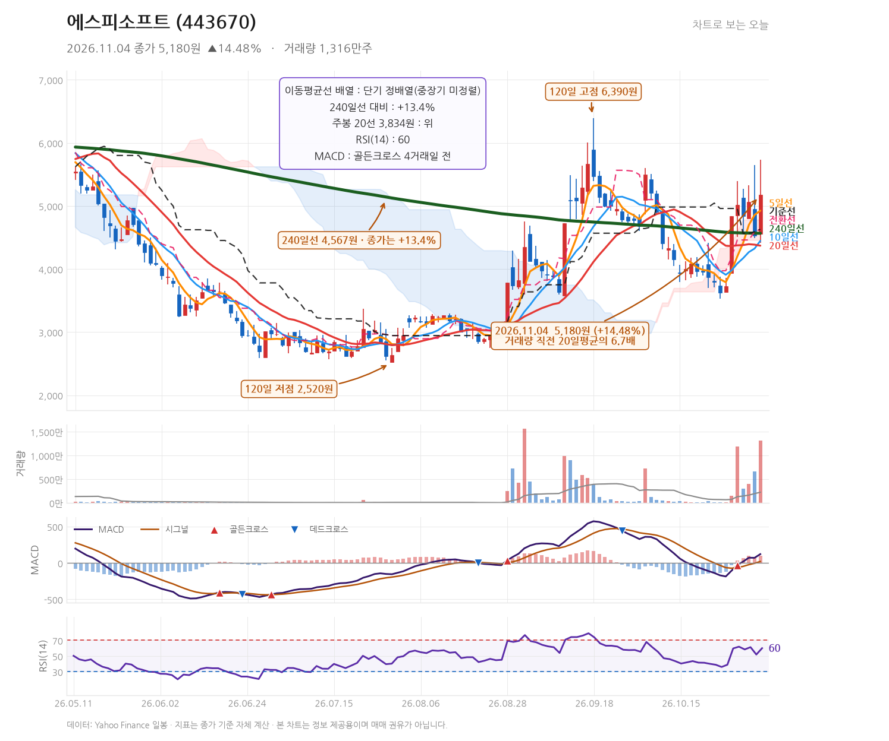

# 발행 지시서 — 2026-11-04 (묶음 글 1편)
작성: DeepSeek API · 발행: 클로드

## 공통 정보
- 블로그: https://mynote86824.tistory.com
- 카테고리: 오늘의 핫종목
- 발행 방식: **비공개** (형 확인 후 공개 전환)
- 형식: **하루 1편 묶음 글** — 종목 2개를 한 글에서 다룸
- 다룬 종목: 셀트리온(068270), 에스피소프트(443670)
- 발행 전 검증: 아래 「검증용 수치」를 Daum API 값과 대조, 금지 문체 확인

## 검증용 수치 (원고 작성에 사용한 값)
| 종목 | 코드 | 종가 | 등락률 | 고가 | 저가 | 거래량 |
|---|---|---|---|---|---|---|
| 셀트리온 | 068270 | 200,000 | +5.32% | 202,500 | 187,500 | 1,088,697 |
| 에스피소프트 | 443670 | 5,180 | +14.48% | 5,730 | 4,410 | 13,147,993 |

---

## 제목
11월 4일 셀트리온 20만원 돌파 +5.32%, 에스피소프트 14.48% 급등

## 태그
#셀트리온 #에스피소프트 #068270 #443670 #차트분석

## 본문 HTML

<b>2026년 11월 4일 셀트리온(068270)은 전일 대비 5.32% 오른 200,000원에 마감했고 거래량은 직전 20거래일 평균의 2.1배였습니다. 에스피소프트(443670)는 14.48% 상승한 5,180원에 마감했으며 거래량은 평균의 6.7배를 기록했습니다.</b>

<h2>셀트리온, 20만원을 넘어선 자리에서 남은 것은 무엇인가</h2>

셀트리온은 이날 190,700원에 출발해 장중 202,500원까지 올랐고 200,000원에 마감했습니다. 전일 종가 189,900원과 비교하면 10,100원 오른 수치입니다. 저가는 187,500원으로 출발가 아래로 밀리는 구간도 있었지만 종가 기준으로는 고가에 가까운 위치를 지켰습니다.

거래량은 1,088,697주로 직전 20거래일 평균의 2.1배였습니다. 가격 상승과 거래량 증가가 같은 방향으로 나온 하루입니다. 다만 2.1배는 폭발적인 수준이라기보다 평소보다 두 배 남짓 늘어난 정도로, 추세 전환의 신호인지 단순한 경계 돌파인지는 며칠 더 확인할 필요가 있습니다.

<table style="border-collapse:collapse;width:100%;" border="1">
<tbody>
<tr><td><b>지표</b></td><td><b>값</b></td><td><b>해석</b></td></tr>
<tr><td>MA5</td><td>192,560원</td><td>종가가 5일선 위에 위치</td></tr>
<tr><td>MA20</td><td>189,610원</td><td>단기 추세선 위 유지</td></tr>
<tr><td>MA240</td><td>188,086원</td><td>종가가 240일선 대비 +6.3%</td></tr>
<tr><td>MACD</td><td>2,590.7 / 시그널 2,191.5</td><td>당일 골든크로스 발생, 히스토그램 +399.1</td></tr>
<tr><td>RSI(14)</td><td>66.3</td><td>과매수 구간에 근접했으나 아직 여유</td></tr>
<tr><td>일목 전환선 / 기준선</td><td>195,000원 / 188,600원</td><td>종가가 두 선 모두 위</td></tr>
</tbody>
</table>

이동평균선은 5일선 192,560원, 10일선 191,990원, 20일선 189,610원으로 정배열을 이루고 있습니다. 240일선 188,086원보다 종가가 6.3% 높은 상태입니다. MACD는 2,590.7로 시그널 2,191.5를 당일 처음 넘어서며 골든크로스가 발생했습니다. RSI는 66.3으로 과열 직전 구간에 들어섰습니다.

가격대를 보면 120일 고점은 212,000원, 52주 고점은 239,244원입니다. 현재 종가는 52주 고점 대비 16.4% 낮은 자리입니다. 위쪽으로는 202,500원(당일 고가)과 212,000원(120일 고점)이 저항 후보이고, 아래쪽으로는 195,000원(전환선)과 188,600원(기준선)이 지지 후보입니다. 종가가 기준선 188,600원 아래로 내려가면 이번 상승 흐름을 다시 점검해야 하는 조건이 됩니다.

뉴스로는 비만약 관련 소식이 나왔습니다. <a href="https://n.news.naver.com/mnews/article/014/0005599540" target="_blank">파이낸셜뉴스</a>는 베일을 벗은 셀트리온 비만약이 근손실을 줄였다고 보도했습니다. 같은 매체는 <a href="https://n.news.naver.com/mnews/article/014/0005599522" target="_blank">제약·음식료가 뜨고 은행·통신이 지는 급락장 속 방어주 희비</a> 기사에서 제약주 흐름을 다뤘습니다. 이날 상승이 개별 재료인지 업종 흐름인지 구분해서 보려면 같은 업종 다른 종목의 당일 움직임을 함께 확인하는 편이 안전합니다.

<h2>에스피소프트, 거래량 6.7배에 윗꼬리까지 남긴 하루</h2>

에스피소프트는 4,555원에 출발해 장중 5,730원까지 치솟았다가 5,180원에 마감했습니다. 전일 종가 4,525원 대비 14.48% 오른 수치입니다. 고가 5,730원과 종가 5,180원의 차이는 550원으로, 장중 고점에서 상당 부분 밀린 채 마감했습니다. 저점은 4,410원으로 출발가보다 낮은 구간도 있었습니다.

거래량은 13,147,993주로 직전 20거래일 평균의 6.7배였습니다. 이날 가장 눈에 띄는 숫자는 이 거래량 배수입니다. 다만 위꼬리가 길게 남았다는 점은 매수세가 고점 부근에서 힘을 잃었다는 뜻으로도 읽힙니다. 거래량이 실린 상승인 동시에 윗꼬리가 긴 캔들이라는 두 가지 성격이 겹쳐 있습니다.

이동평균선은 5일선 4,925원, 10일선 4,447원, 20일선 4,370원으로 단기 정배열이지만 240일선 4,567원과의 관계는 아직 정리되지 않았습니다. 종가는 240일선 대비 13.4% 위에 있습니다. MACD는 121.0으로 시그널 20.4를 크게 웃돌고 히스토그램이 +100.6이며, 골든크로스는 4거래일 전에 발생했습니다. RSI는 60.0으로 과열권까지는 여유가 있습니다. 일목 전환선과 기준선이 4,630원으로 같아, 이 가격대가 단기 균형점 역할을 하고 있습니다.

가격대는 120일 고점 6,390원, 52주 고점 7,290원이 위쪽에 있고 현재는 52주 고점 대비 28.9% 낮습니다. 아래쪽은 당일 저가 4,410원과 10일선 4,447원, 20일선 4,370원이 지지 후보입니다. 종가가 4,630원(전환선·기준선) 아래로 내려가면 이번 급등분을 되돌리는 흐름으로 봐야 합니다.

재료는 <a href="https://n.news.naver.com/mnews/article/003/0014299961" target="_blank">뉴시스</a>가 전한 AI·PQC 결합 차세대 방화벽 개발 완료 소식입니다. <a href="https://n.news.naver.com/mnews/article/119/0003150444" target="_blank">데일리안</a>은 해킹 공포에 보안주가 들썩이며 테마를 넘어 실적주가 될 수 있을지 짚는 기사를 냈습니다. 이 종목은 보안 솔루션을 다루는 코스닥 기업으로, 테마성 수급이 붙을 때 변동성이 크게 나타나는 편입니다.

<h2>종목별 다음 관전 포인트</h2>

셀트리온은 종가 200,000원을 기준으로 202,500원(당일 고가)과 212,000원(120일 고점)을 차례로 시험하는지가 첫 번째 관전 포인트입니다. 반대로 195,000원(전환선)과 188,600원(기준선)을 종가가 이탈하는지가 추세 유지 여부를 가르는 조건입니다. MACD 골든크로스가 발생한 첫날이라는 점도 며칠간 이어지는지 확인할 부분입니다.

에스피소프트는 5,730원(당일 고가)을 다시 넘어서는지, 아니면 4,630원(전환선·기준선)을 지키는지가 핵심입니다. 6.7배 거래량이 하루로 끝나는지 며칠 이어지는지도 함께 봐야 합니다. 두 종목은 업종과 사업 영역이 겹치지 않아 하나의 흐름으로 묶어 볼 근거가 없으며, 각각의 가격대만 따로 추적하는 것이 맞습니다.

※ 본 글은 기업 및 주가에 대한 정보와 분석을 제공하기 위한 목적으로 작성되었으며, 특정 금융투자상품의 매수·매도 또는 투자를 권유하지 않습니다. 
※ 본문에 포함된 실적 전망, 목표주가, 예상 EPS 등 미래 관련 수치는 시장 컨센서스 또는 전망치이며 확정된 결과가 아닙니다. 
※ 차트의 주요 가격대와 기술적 분석은 작성 시점의 데이터를 기준으로 한 분석 의견이며, 향후 주가 움직임을 보장하지 않습니다. 
※ 투자 판단은 각 투자자의 독립적인 판단과 책임에 따라 이루어져야 합니다. 
※ 작성자는 해당 종목을 보유하지 않고 있으며, 본 글은 이해관계와 무관하게 작성되었습니다.

▶ <a href="https://mynote86824.tistory.com/pages/누적-수익률" target="_blank">누적 수익률 전체 보기</a>

