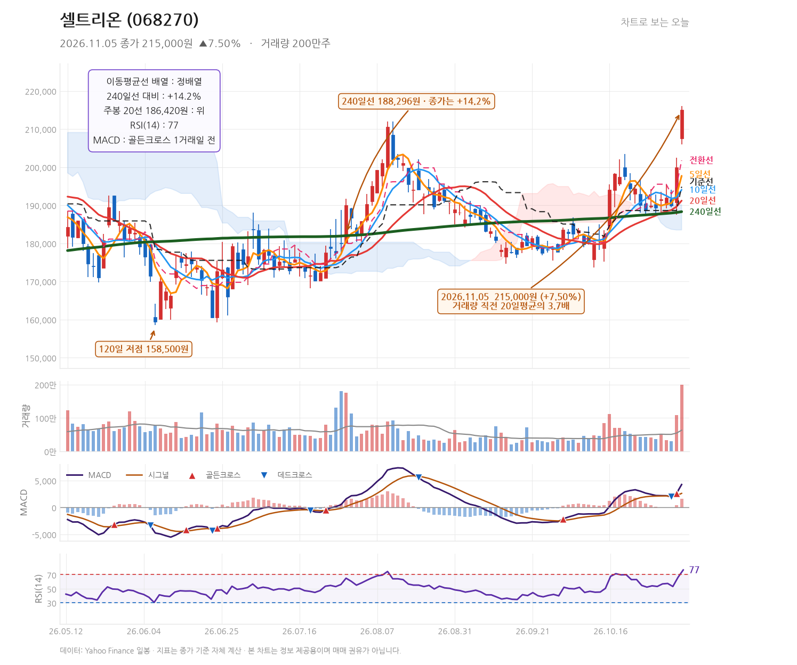
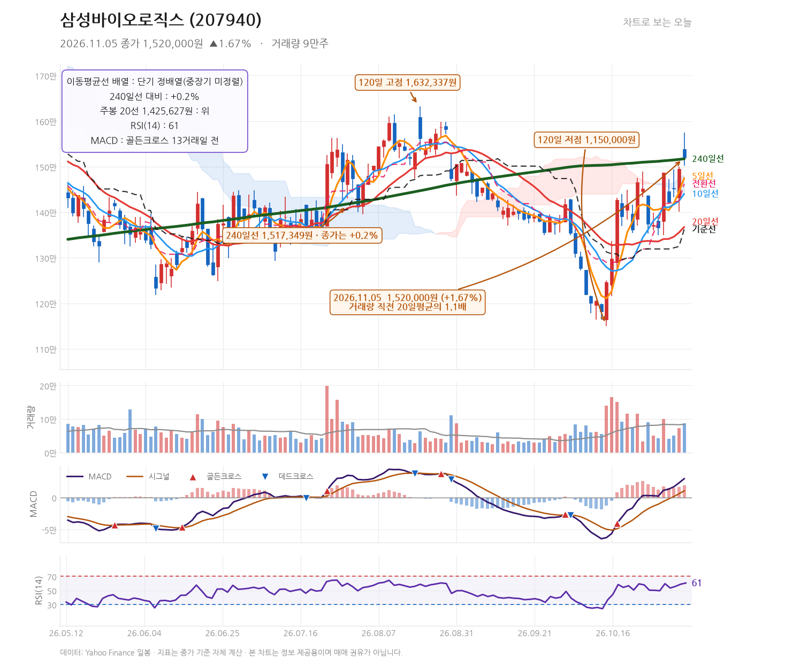

# 발행 지시서 — 2026-11-05 (묶음 글 1편)
작성: DeepSeek API · 발행: 클로드

## 공통 정보
- 블로그: https://mynote86824.tistory.com
- 카테고리: 오늘의 핫종목
- 발행 방식: **비공개** (형 확인 후 공개 전환)
- 형식: **하루 1편 묶음 글** — 종목 2개를 한 글에서 다룸
- 다룬 종목: 셀트리온(068270), 삼성바이오로직스(207940)
- 발행 전 검증: 아래 「검증용 수치」를 Daum API 값과 대조, 금지 문체 확인

## 검증용 수치 (원고 작성에 사용한 값)
| 종목 | 코드 | 종가 | 등락률 | 고가 | 저가 | 거래량 |
|---|---|---|---|---|---|---|
| 셀트리온 | 068270 | 215,000 | +7.50% | 216,000 | 206,000 | 1,999,863 |
| 삼성바이오로직스 | 207940 | 1,520,000 | +1.67% | 1,575,000 | 1,502,000 | 88,028 |

---

## 제목
11월 5일 셀트리온 +7.50%·삼성바이오로직스 +1.67%, 거래량과 240일선이 갈린 두 종목

## 태그
#셀트리온 #삼성바이오로직스 #068270 #207940 #차트분석

## 본문 HTML

<b>2026년 11월 5일 셀트리온(068270)은 215,000원(+7.50%)에 마감하며 직전 20거래일 평균의 3.7배에 달하는 1,999,863주가 거래됐습니다. 삼성바이오로직스(207940)는 1,520,000원(+1.67%)에 마감했고 거래량은 88,028주로 평균의 1.1배 수준이었습니다.</b>

<h3>셀트리온, 하루 만에 240일선 위로 14.2% 벌어진 이유는 무엇인가</h3>

이날 셀트리온의 출발가는 207,500원이었습니다. 전일 종가 200,000원에서 이미 3.75% 갭업한 상태로 시작했고, 장중 저가 206,000원까지 눌린 뒤 다시 밀어 올려 고가 216,000원까지 찍고 215,000원에 마감했습니다. 시가와 저가가 거의 붙어 있고 종가가 고가에 1,000원 차이로 붙은 흐름은 장 초반 매물을 소화한 뒤 종일 매수 우위가 유지됐다는 뜻으로 읽힙니다.

가장 눈에 띄는 숫자는 거래량입니다. 1,999,863주는 직전 20거래일 평균의 3.7배로, 최근 한 달 사이 가장 강한 수급이 유입된 날입니다. 가격 상승과 거래량 급증이 같은 날 겹쳤다는 점에서 단순 반등이 아닌 추세 전환 시도로 볼 여지가 있습니다.

이동평균선은 5일선 197,700원, 10일선 194,060원, 20일선 191,185원, 240일선 188,296원으로 완전한 정배열입니다. 종가 215,000원은 240일선 대비 14.2% 위에 있습니다. 주봉 20선 186,420원도 이미 아래로 내려가 중기 추세 지지선 역할을 하고 있습니다.

<table style="border-collapse:collapse;width:100%;" border="1">
<tbody>
<tr><td><b>지표</b></td><td><b>값</b></td><td><b>해석</b></td></tr>
<tr><td>MACD</td><td>4,247.2 / 시그널 2,602.7 / 히스토그램 1,644.5</td><td>1거래일 전 골든크로스 발생, 히스토그램 확장 중</td></tr>
<tr><td>RSI(14)</td><td>76.7</td><td>과매수 구간 진입, 단기 속도 부담</td></tr>
<tr><td>일목 전환선 / 기준선</td><td>201,750원 / 194,850원</td><td>종가가 두 선 모두 위에 위치</td></tr>
<tr><td>52주 고점 대비</td><td>-10.1% (고점 239,244원)</td><td>전고점까지 여유 남아 있음</td></tr>
</tbody>
</table>

MACD가 1거래일 전 골든크로스를 만들었고 히스토그램이 1,644.5로 벌어지고 있습니다. 다만 RSI가 76.7로 과매수권에 들어섰다는 점은 단기 급등 부담으로 남습니다. 120일 고점이 216,000원인데 이날 고가가 정확히 216,000원이었습니다. 즉 이날 장중 고점이 곧 120일 최고가였고, 종가는 그 아래인 215,000원에서 마감했습니다.

뉴스 흐름을 보면 이날 상승에 매크로 재료가 겹쳤습니다. 매일경제는 미국 민주당 압승에 따른 수혜 기대감으로 현대차·셀트리온을 함께 언급했고(<a href="https://n.news.naver.com/mnews/article/009/0005759748" target="_blank">링크</a>), 한국경제는 미국발 정치 이벤트가 한국 증시에 미친 영향을 다뤘습니다(<a href="https://n.news.naver.com/mnews/article/015/0005350832" target="_blank">링크</a>). 다만 같은 날 여성신문은 코스피가 블루웨이브 쇼크로 5,500선이 붕괴됐다고 전했습니다(<a href="https://n.news.naver.com/mnews/article/310/0000141481" target="_blank">링크</a>). 지수 전반이 흔들린 날 셀트리온만 7.5% 올랐다는 점은 종목 고유의 수급이 작용했다는 신호로 볼 수 있으나, 매크로 헤드라인만으로 이 상승 폭을 설명하기는 어렵습니다.

추세가 무효화되는 조건은 20일선 191,185원과 240일선 188,296원을 연속으로 종가 기준 이탈하는 경우입니다. 상단에서는 216,000원(120일 고점)을 종가로 넘기는지가 첫 관문이고, 그 위로는 52주 고점 239,244원이 남아 있습니다.

<h3>삼성바이오로직스, 240일선에 딱 붙은 1,520,000원의 의미</h3>

삼성바이오로직스는 출발가 1,539,000원으로 전일 종가 1,495,000원 대비 2.94% 갭업 출발했습니다. 장중 1,575,000원까지 올랐지만 종가는 1,520,000원으로, 고가 대비 55,000원(약 3.5%)을 반납했습니다. 윗꼬리가 짧지 않은 캔들입니다.

거래량은 88,028주로 직전 20거래일 평균의 1.1배에 그쳤습니다. 셀트리온이 3.7배로 터진 것과 비교하면 수급의 강도 자체가 다릅니다. 가격은 올랐지만 거래가 폭발적으로 늘지는 않았다는 뜻입니다.

가장 중요한 숫자는 240일선입니다. 240일선이 1,517,349원인데 종가가 1,520,000원으로, 겨우 0.2% 위에 걸쳐 있습니다. 장기 추세선에 몸통이 닿아 있는 위치입니다. 단기선은 5일선 1,475,200원, 10일선 1,440,600원, 20일선 1,367,750원으로 정배열이지만 중장기 배열은 아직 정리되지 않았다는 평가가 나옵니다.

MACD는 13거래일 전 골든크로스가 발생했고 히스토그램이 18,848.9까지 벌어져 있습니다. 셀트리온보다 훨씬 이른 시점에 크로스가 났는데도 가격 반응은 완만했다는 점이 대조적입니다. RSI는 60.6으로 과열권과는 거리가 있습니다.

이날 뉴스에서는 두 가지가 눈에 띕니다. 한국경제는 폴리펩타이드 공개매수로 삼성바이오로직스 지분 98%를 확보했다고 보도했고(<a href="https://n.news.naver.com/mnews/article/015/0005350853" target="_blank">링크</a>), 한국경제TV는 삼성바이오로직스 노조가 또 파업에 나선다는 소식을 전했습니다(<a href="https://n.news.naver.com/mnews/article/215/0001271817" target="_blank">링크</a>). 지배구조 관련 재료와 노사 리스크가 같은 날 나온 셈입니다. 지디넷코리아의 AI 온톨로지 관련 기사(<a href="https://n.news.naver.com/mnews/article/092/0002444130" target="_blank">링크</a>)는 이 종목과 직접 연결되는 내용이 아니어서 주가 재료로 보기는 어렵습니다.

지지선은 240일선 1,517,349원과 일목 전환선 1,462,500원입니다. 종가 기준으로 240일선을 이탈하면 장기 추세 위에 서 있다는 근거가 사라지고, 다음 방어선은 전환선 1,462,500원, 그 아래 기준선 1,362,500원이 됩니다. 상단은 이날 고가 1,575,000원, 그 위로 120일 고점 1,632,337원입니다. 52주 고점 1,971,704원 대비로는 아직 22.9% 낮은 자리에 있습니다.

<h3>종목별 다음 관전 포인트</h3>

셀트리온은 이날 120일 고점과 같은 216,000원에서 고점을 만들었습니다. 다음 거래일 종가가 216,000원을 넘겨 마감하는지가 첫 번째 확인 지점이고, 실패하면 5일선 197,700원까지 되돌림이 나올 수 있습니다. RSI 76.7은 단기 과열 신호이므로 추격보다는 눌림에서 지지 여부를 보는 편이 합리적입니다. 20일선 191,185원과 240일선 188,296원이 추세 유지의 마지노선입니다.

삼성바이오로직스는 종가가 240일선 1,517,349원에 0.2% 차이로 붙어 있습니다. 다음 거래일 이 선 위에서 종가를 유지하는지가 최우선 관찰 대상입니다. 유지되면 1,575,000원 → 1,632,337원 순으로 열리고, 이탈하면 1,462,500원이 다음 지지선입니다. 거래량이 평균의 1.1배에 그쳤다는 점에서 방향 확인에는 아직 시간이 필요합니다.

두 종목은 같은 KOSPI 대형주이지만 이날 상승의 성격이 달랐습니다. 셀트리온은 거래량 3.7배와 7.5% 상승이 결합된 반면, 삼성바이오로직스는 1.1배 거래량에 1.67% 상승으로 장기 이동평균선에 걸쳐 있는 상태입니다. 업종이 겹치지 않고 이날 확인된 뉴스 재료도 서로 다르므로, 두 종목을 하나의 흐름으로 묶어 해석할 근거는 없습니다. 각각의 가격대만 따로 보는 것이 맞습니다.

※ 본 글은 기업 및 주가에 대한 정보와 분석을 제공하기 위한 목적으로 작성되었으며, 특정 금융투자상품의 매수·매도 또는 투자를 권유하지 않습니다. 
※ 본문에 포함된 실적 전망, 목표주가, 예상 EPS 등 미래 관련 수치는 시장 컨센서스 또는 전망치이며 확정된 결과가 아닙니다. 
※ 차트의 주요 가격대와 기술적 분석은 작성 시점의 데이터를 기준으로 한 분석 의견이며, 향후 주가 움직임을 보장하지 않습니다. 
※ 투자 판단은 각 투자자의 독립적인 판단과 책임에 따라 이루어져야 합니다. 
※ 작성자는 해당 종목을 보유하지 않고 있으며, 본 글은 이해관계와 무관하게 작성되었습니다.

▶ <a href="https://mynote86824.tistory.com/pages/누적-수익률" target="_blank">누적 수익률 전체 보기</a>

