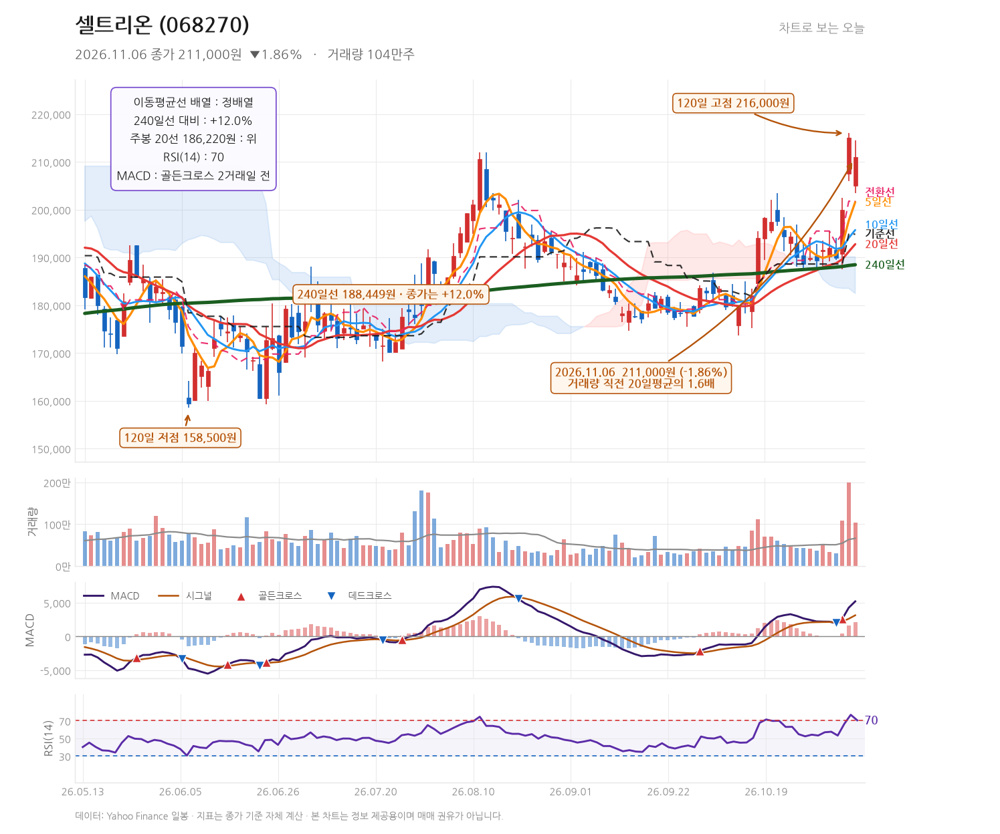
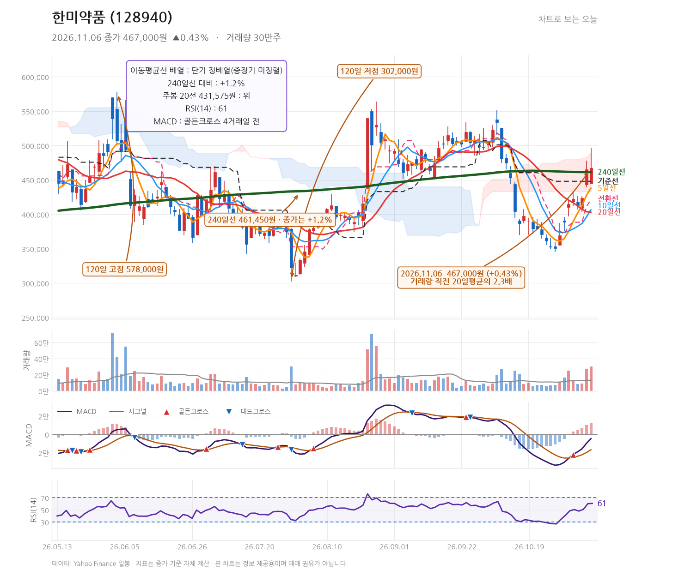

# 발행 지시서 — 2026-11-06 (묶음 글 1편)
작성: DeepSeek API · 발행: 클로드

## 공통 정보
- 블로그: https://mynote86824.tistory.com
- 카테고리: 오늘의 핫종목
- 발행 방식: **비공개** (형 확인 후 공개 전환)
- 형식: **하루 1편 묶음 글** — 종목 2개를 한 글에서 다룸
- 다룬 종목: 셀트리온(068270), 한미약품(128940)
- 발행 전 검증: 아래 「검증용 수치」를 Daum API 값과 대조, 금지 문체 확인

## 검증용 수치 (원고 작성에 사용한 값)
| 종목 | 코드 | 종가 | 등락률 | 고가 | 저가 | 거래량 |
|---|---|---|---|---|---|---|
| 셀트리온 | 068270 | 211,000 | -1.86% | 214,500 | 203,500 | 1,036,576 |
| 한미약품 | 128940 | 467,000 | +0.43% | 497,000 | 444,000 | 302,738 |

---

## 제목
11월 6일 셀트리온 -1.86%·한미약품 +0.43%, 거래량 1.6배·2.3배 늘어난 두 제약주

## 태그
#셀트리온 #한미약품 #제약주 #차트분석 #주식블로그

## 본문 HTML

<b>2026년 11월 6일 셀트리온(068270)은 211,000원으로 전일 대비 1.86% 하락했고 거래량은 직전 20거래일 평균의 1.6배였습니다. 한미약품(128940)은 467,000원으로 0.43% 올랐고 거래량은 평균의 2.3배를 기록했습니다.</b>

두 종목 모두 평소보다 거래가 크게 늘어난 날이었습니다. 다만 방향은 정반대였습니다. 셀트리온은 장 초반 205,000원에서 출발해 214,500원까지 올랐다가 211,000원으로 마감했고, 한미약품은 444,500원에서 출발해 장중 497,000원까지 치솟은 뒤 467,000원으로 되돌아왔습니다. 두 종목 모두 위쪽에서 밀린 흔적이 남은 캔들이지만, 출발가와 종가의 관계는 서로 달랐습니다.

<h3>셀트리온, 120일 고점 216,000원을 앞에 두고 밀린 이유는 무엇인가</h3>

셀트리온은 205,000원에 출발했습니다. 전일 종가 215,000원보다 낮은 자리에서 시작했고, 장중 214,500원까지 반등했으나 전일 종가를 넘어서지는 못했습니다. 종가 211,000원은 고가 대비 3,500원 낮은 자리입니다. 위꼬리가 짧지 않은 하락 마감 캔들입니다.

그런데 이동평균선 구조는 여전히 위쪽을 향해 있습니다. 5일선 201,580원, 10일선 195,720원, 20일선 192,755원, 240일선 188,449원으로 완전한 정배열입니다. 종가는 240일선 대비 12.0% 높은 자리에 있습니다. 하루 하락으로 추세가 꺾였다고 보기는 어려운 위치입니다.

<table style="border-collapse:collapse;width:100%;" border="1">
<tbody>
<tr><td><b>지표</b></td><td><b>값</b></td><td><b>해석</b></td></tr>
<tr><td>MACD</td><td>5,177.5 / 시그널 3,117.6 / 히스토그램 2,059.9</td><td>2거래일 전 골든크로스 이후 히스토그램이 양수로 유지되는 중입니다.</td></tr>
<tr><td>RSI(14)</td><td>70.5</td><td>과매수 경계선인 70을 살짝 웃도는 수준입니다. 상승 탄력이 강하지만 단기 과열 부담도 함께 있는 자리입니다.</td></tr>
<tr><td>일목 전환선 / 기준선</td><td>201,750원 / 194,850원</td><td>종가가 두 선 모두 위에 있어 구름대 상향 구조가 유지되고 있습니다.</td></tr>
<tr><td>주봉 20선</td><td>186,220원</td><td>중기 흐름의 하단 지지 후보로 볼 수 있는 자리입니다.</td></tr>
</tbody>
</table>

가격대를 정리하면 이렇습니다. 위쪽으로는 120일 고점 216,000원이 첫 번째 저항이고, 그 위에 52주 고점 239,244원이 있습니다. 현재가는 52주 고점 대비 11.8% 낮은 자리입니다. 아래쪽으로는 5일선 201,580원과 전환선 201,750원이 거의 겹쳐 있어 이 구간이 단기 지지선 역할을 하는지가 관건입니다. 이 두 선을 종가 기준으로 내준다면 10일선 195,720원까지 시야가 넓어질 수 있습니다.

뉴스 흐름을 보면 이날 하락이 회사 고유의 악재 때문이라고 단정할 근거는 확인되지 않습니다. 같은 날 나온 기사 중에는 미국 증시 급락과 외국인 수급을 다룬 시장 전반 기사가 포함되어 있습니다. 반면 회사와 직접 연결되는 소식으로는 셀트리온이 삼성·롯데와 CMO(위탁생산) 협력을 논의한다는 보도가 있었습니다. <a href="https://n.news.naver.com/mnews/article/003/0014306755" target="_blank">주문이 넘쳐서 셀트리온, 삼성·롯데와 CMO 손잡는다 (뉴시스)</a>

정리하면 셀트리온은 상승 추세 한가운데에서 하루 조정을 받은 그림입니다. 다만 RSI가 70을 넘고 120일 고점이 코앞에 있어, 추가 상승을 위해서는 거래량을 동반한 216,000원 돌파가 필요해 보입니다.

<h3>한미약품, 장중 497,000원까지 찍고 되돌린 하루</h3>

한미약품의 이날 캔들은 변동폭이 컸습니다. 444,500원에 출발해 저가 444,000원을 만들고 장중 497,000원까지 올랐습니다. 고가와 저가의 차이가 53,000원에 달합니다. 종가는 467,000원으로 전일 종가 465,000원보다 2,000원 높은 수준에서 마감했습니다. 상승폭은 0.43%에 그쳤지만, 장중 고점 대비로는 30,000원을 반납한 셈입니다.

거래량은 직전 20거래일 평균의 2.3배였습니다. 두 종목 중 가장 큰 증가 폭입니다. 이 정도 거래량이 실린 윗꼬리 긴 양봉은 매수세와 매도세가 그만큼 치열하게 맞붙었다는 뜻으로 읽힙니다.

이동평균선은 단기와 중장기가 엇갈려 있습니다. 5일선 438,200원, 10일선 406,700원, 20일선 403,100원으로 단기는 정배열이지만, 240일선 461,450원과의 관계는 아직 정리되지 않았습니다. 종가는 240일선보다 1.2% 높은 자리로, 이제 막 연간선 위로 올라선 상태입니다. 240일선이 461,450원에 있어 종가 467,000원과의 거리가 5,550원밖에 되지 않습니다. 이 선을 지키느냐가 중기 추세 판단의 분수령이 될 수 있습니다.

MACD는 4거래일 전 골든크로스를 만들었고 히스토그램이 12,071.4로 양수를 가리키고 있습니다. 다만 MACD 값 자체가 -4,631.8로 아직 0선 아래에 있습니다. 지표가 개선 방향으로 가고 있으나 완전히 자리 잡지는 않았다는 의미입니다. RSI는 60.7로 셀트리온보다 낮아 과열 부담은 덜합니다.

가격대는 위아래가 뚜렷합니다. 위로는 일목 기준선 448,000원을 이미 넘어섰고, 이날 고점 497,000원이 1차 저항으로 남았습니다. 그 위로는 120일 고점 578,000원이 있습니다. 아래로는 기준선 448,000원과 240일선 461,450원이 지지 후보입니다. 52주 고점 647,000원 대비로는 27.8% 낮은 자리입니다.

이날 나온 회사 관련 소식은 국산 1호 비만약에 이어 '에피데이' 앱을 공개했다는 보도입니다. <a href="https://n.news.naver.com/mnews/article/119/0003152345" target="_blank">국산 1호 비만약 이어… 한미약품, '에피데이' 앱 공개 (데일리안)</a> 업종 전반의 수익성에 주목하는 기사도 함께 나왔습니다. <a href="https://n.news.naver.com/mnews/article/296/0000106993" target="_blank">해외 판매 늘고 기술료 쌓이고⋯제약사 수익성 주목 (코메디닷컴)</a>

<h3>종목별 다음 관전 포인트</h3>

셀트리온은 216,000원(120일 고점)을 거래량과 함께 돌파하는지, 그리고 201,580원 부근의 5일선과 전환선이 종가 기준으로 지켜지는지를 봐야 합니다. 이 두 선을 내주면 195,720원의 10일선까지 조정이 이어질 수 있습니다.

한미약품은 461,450원의 240일선 위에서 종가를 유지하는지가 첫 번째 관문입니다. 위쪽으로는 497,000원 돌파 여부, 아래쪽으로는 448,000원 기준선 이탈 여부를 함께 확인할 필요가 있습니다.

두 종목은 같은 제약 업종에 속하지만, 이날 확인된 뉴스와 재료가 서로 다릅니다. 셀트리온은 CMO 협력 보도가, 한미약품은 비만약 앱 공개 소식이 각각 나왔을 뿐 두 회사를 하나의 재료로 묶어 볼 근거는 데이터에서 확인되지 않습니다. 따라서 두 종목은 각자의 가격대를 기준으로 따로 추적하는 편이 합리적입니다.

※ 본 글은 기업 및 주가에 대한 정보와 분석을 제공하기 위한 목적으로 작성되었으며, 특정 금융투자상품의 매수·매도 또는 투자를 권유하지 않습니다. 
※ 본문에 포함된 실적 전망, 목표주가, 예상 EPS 등 미래 관련 수치는 시장 컨센서스 또는 전망치이며 확정된 결과가 아닙니다. 
※ 차트의 주요 가격대와 기술적 분석은 작성 시점의 데이터를 기준으로 한 분석 의견이며, 향후 주가 움직임을 보장하지 않습니다. 
※ 투자 판단은 각 투자자의 독립적인 판단과 책임에 따라 이루어져야 합니다. 
※ 작성자는 해당 종목을 보유하지 않고 있으며, 본 글은 이해관계와 무관하게 작성되었습니다.

▶ <a href="https://mynote86824.tistory.com/pages/누적-수익률" target="_blank">누적 수익률 전체 보기</a>

