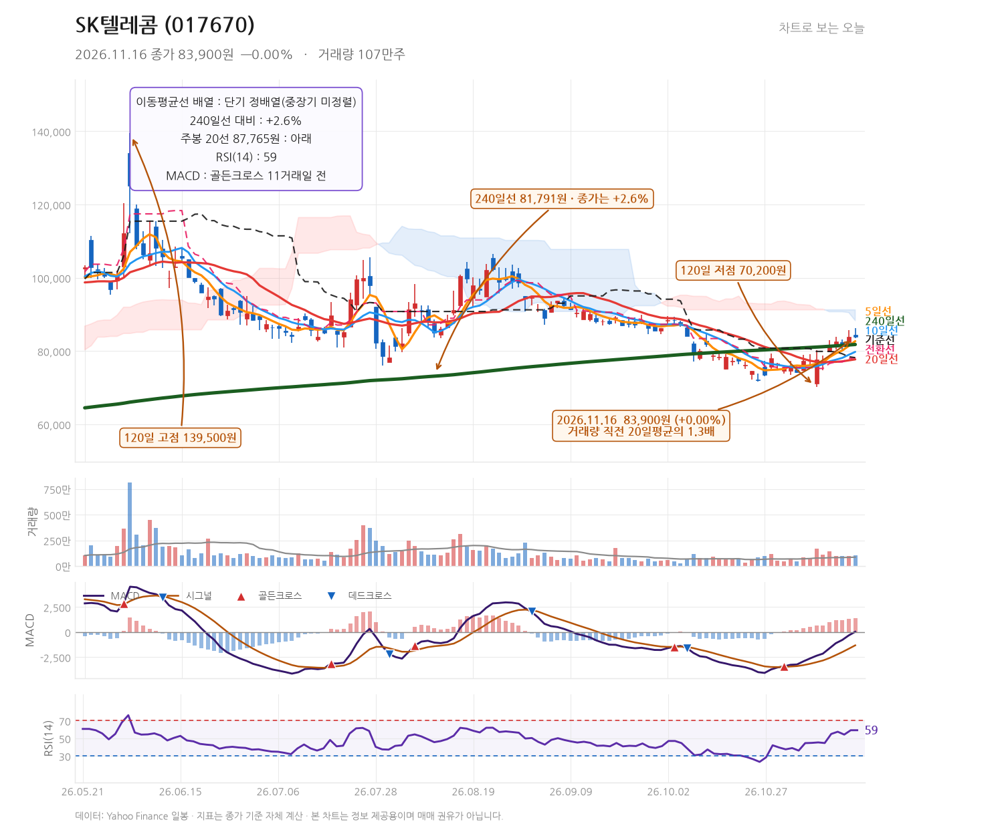
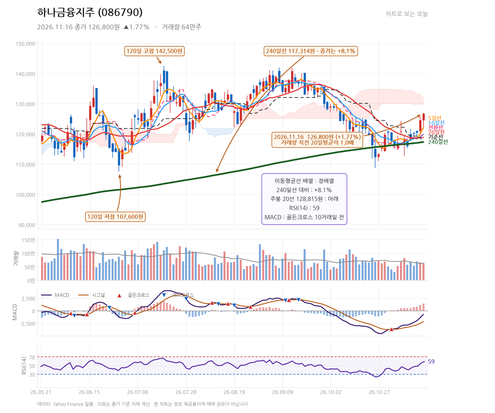

# 발행 지시서 — 2026-11-16 (묶음 글 1편)
작성: DeepSeek API · 발행: 클로드

## 공통 정보
- 블로그: https://mynote86824.tistory.com
- 카테고리: 오늘의 핫종목
- 발행 방식: **비공개** (형 확인 후 공개 전환)
- 형식: **하루 1편 묶음 글** — 종목 2개를 한 글에서 다룸
- 다룬 종목: SK텔레콤(017670), 하나금융지주(086790)
- 발행 전 검증: 아래 「검증용 수치」를 Daum API 값과 대조, 금지 문체 확인

## 검증용 수치 (원고 작성에 사용한 값)
| 종목 | 코드 | 종가 | 등락률 | 고가 | 저가 | 거래량 |
|---|---|---|---|---|---|---|
| SK텔레콤 | 017670 | 83,900 | +0.00% | 86,200 | 83,600 | 1,069,186 |
| 하나금융지주 | 086790 | 126,800 | +1.77% | 127,000 | 121,700 | 636,627 |

---

## 제목
SK텔레콤 8만3900원 보합, 하나금융지주 12만6800원 1.77% 상승 마감

## 태그
#SK텔레콤 #하나금융지주 #주가분석 #차트분석 #코스피

## 본문 HTML

<b>2026년 11월 16일 SK텔레콤(017670)은 8만3900원으로 보합 마감했고, 하나금융지주(086790)는 12만6800원으로 1.77% 올랐습니다. SK텔레콤 거래량은 직전 20거래일 평균의 1.3배, 하나금융지주는 1.0배였습니다.</b>

<h3>SK텔레콤, 장중 8만6200원 찍고 되밀린 하루</h3>

SK텔레콤은 이날 8만4500원에 출발해 장중 8만6200원까지 올랐지만, 종가 기준으로는 전일과 같은 8만3900원을 기록했습니다. 고가 대비 2300원을 반납한 윗꼬리 캔들입니다. 저가는 8만3600원이었습니다. 거래량은 106만9186주로 직전 20거래일 평균의 1.3배 수준이었습니다.

<h4>이동평균선은 어떤 상태인가</h4>
<table style="border-collapse:collapse;width:100%;" border="1">
<tbody>
<tr><td><b>지표</b></td><td><b>값</b></td><td><b>해석</b></td></tr>
<tr><td>MA5</td><td>82,700원</td><td>종가가 5일선 위에 위치</td></tr>
<tr><td>MA20</td><td>77,730원</td><td>단기선과 약 7.9% 격차</td></tr>
<tr><td>MA240</td><td>81,791원</td><td>종가가 240일선 대비 +2.6%</td></tr>
<tr><td>주봉 20선</td><td>87,765원</td><td>종가가 아직 아래</td></tr>
<tr><td>RSI(14)</td><td>59.2</td><td>중립 상단, 과열 아님</td></tr>
<tr><td>MACD</td><td>28.4 / 시그널 -1325.6</td><td>11거래일 전 골든크로스 유지</td></tr>
</tbody>
</table>

단기 이평선은 5일선 8만2700원, 10일선 7만9780원, 20일선 7만7730원으로 정배열을 이루고 있습니다. 다만 240일선(8만1791원)과 주봉 20선(8만7765원)이 위쪽에 자리해 중장기 배열은 아직 정리되지 않은 상태입니다. 52주 고점 13만9500원 대비로는 -39.9% 수준입니다.

<h4>무엇이 이날 움직임에 영향을 줬나</h4>

효성중공업과 손잡고 GW급 AI 데이터센터 구축에 나선다는 소식이 전해졌습니다(<a href="https://n.news.naver.com/mnews/article/014/0005605046" target="_blank">파이낸셜뉴스</a>). 같은 날 '뉴스룸 굿체인지 캠페인'이 한국 PR대상 최우수상으로 선정됐다는 보도도 있었습니다(<a href="https://n.news.naver.com/mnews/article/030/0003486318" target="_blank">전자신문</a>). 한편 '모두의 AI' 출시를 앞두고 경쟁 서비스 '피클'의 움직임을 다룬 기사에서는 보안 측면의 과제가 함께 언급됐습니다(<a href="https://n.news.naver.com/mnews/article/032/0003482994" target="_blank">경향신문</a>).

<h4>다음에 확인할 가격대</h4>

윗꼬리가 길었던 만큼 8만6200원 부근에서 매물이 나왔다는 점이 확인됩니다. 위쪽으로는 주봉 20선인 8만7765원이 1차 저항선으로 남아 있습니다. 아래쪽에서는 240일선 8만1791원과 5일선 8만2700원이 지지 여부를 가늠할 구간입니다. 이 두 선을 연달아 이탈하면 이번 단기 정배열 흐름이 무효화되는 것으로 볼 수 있습니다. 일목 전환선과 기준선은 모두 7만8200원으로, 균형선 아래로 내려가면 추세 판단을 다시 해야 합니다.

<h3>하나금융지주, 거래량 그대로 1.77% 상승</h3>

하나금융지주는 12만4600원에 출발해 12만7000원까지 오른 뒤 12만6800원으로 마감했습니다. 시가와 전일 종가가 같고, 종가는 시가보다 2200원 높습니다. 저점은 12만1700원이었습니다. 거래량은 63만6627주로 직전 20거래일 평균과 사실상 같은 1.0배였습니다. 가격은 올랐지만 거래량이 늘지 않은 하루였다는 점이 눈에 띕니다.

<h4>이평선과 지표는 정배열을 유지하고 있나</h4>

5일선 12만2080원, 10일선 11만9870원, 20일선 11만8870원, 240일선 11만7314원으로 완전한 정배열입니다. 종가는 240일선 대비 +8.1% 위에 있습니다. RSI는 59.2로 SK텔레콤과 같은 수치지만, MACD는 -734.3으로 시그널(-2164.4)을 10거래일 전에 상향 돌파한 상태를 유지하고 있습니다. 52주 고점 14만2500원 대비로는 -11.0%로, 낙폭이 SK텔레콤보다 훨씬 작습니다.

<h4>뉴스는 무엇을 말하고 있나</h4>

웹케시와 함께 기업 자금관리 AI서비스를 검증한다는 소식이 있었습니다(<a href="https://n.news.naver.com/mnews/article/014/0005605043" target="_blank">파이낸셜뉴스</a>). 다만 같은 날 시장 전반은 엔비디아 관련 충격으로 코스피가 3.59%, 코스닥이 4.86% 급락했다는 보도가 나왔습니다(<a href="https://n.news.naver.com/mnews/article/022/0004175568" target="_blank">세계일보</a>). 증시가 흔들리는 가운데 5년래 최대 순매도가 나왔다는 기사도 함께 전해졌습니다(<a href="https://n.news.naver.com/mnews/article/011/0004682801" target="_blank">서울경제</a>). 지수 급락일에도 이 종목이 상승 마감했다는 점은 수급 면에서 의미가 있지만, 거래량이 평균 수준이었다는 점에서 강한 매수세가 붙었다고 단정하기는 어렵습니다.

<h4>지지와 저항, 그리고 무효화 조건</h4>

위쪽으로는 주봉 20선 12만8815원이 종가 바로 위에 있어 1차 저항입니다. 이 선을 종가로 넘어서면 52주 고점 14만2500원까지의 구간이 열립니다. 아래쪽 지지는 5일선 12만2080원과 20일선 11만8870원입니다. 일목 전환선 11만9850원, 기준선 11만7850원도 함께 봐야 합니다. 20일선과 기준선을 동시에 이탈하면 정배열이 흔들리는 신호로 판단할 수 있습니다.

<h3>종목별 다음 관전 포인트</h3>

SK텔레콤과 하나금융지주는 통신과 금융으로 업종이 다르고, 이날 보도된 뉴스도 서로 연결되지 않습니다. 두 종목을 하나의 흐름으로 묶어 볼 근거는 없으며, 각각의 가격대만 따로 정리합니다.

<ul>
<li><b>SK텔레콤</b>: 위쪽은 주봉 20선 8만7765원 돌파 여부, 아래쪽은 240일선 8만1791원과 5일선 8만2700원의 지지 유지 여부를 봅니다. 이 두 선을 이탈하면 단기 정배열이 무효화됩니다.</li>
<li><b>하나금융지주</b>: 위쪽은 주봉 20선 12만8815원, 아래쪽은 20일선 11만8870원과 일목 기준선 11만7850원입니다. 거래량이 평균 수준에 머문 점을 감안해 다음 상승 시 거래량 동반 여부를 함께 확인할 필요가 있습니다.</li>
</ul>

※ 본 글은 기업 및 주가에 대한 정보와 분석을 제공하기 위한 목적으로 작성되었으며, 특정 금융투자상품의 매수·매도 또는 투자를 권유하지 않습니다. 
※ 본문에 포함된 실적 전망, 목표주가, 예상 EPS 등 미래 관련 수치는 시장 컨센서스 또는 전망치이며 확정된 결과가 아닙니다. 
※ 차트의 주요 가격대와 기술적 분석은 작성 시점의 데이터를 기준으로 한 분석 의견이며, 향후 주가 움직임을 보장하지 않습니다. 
※ 투자 판단은 각 투자자의 독립적인 판단과 책임에 따라 이루어져야 합니다. 
※ 작성자는 해당 종목을 보유하지 않고 있으며, 본 글은 이해관계와 무관하게 작성되었습니다.

▶ <a href="https://mynote86824.tistory.com/pages/누적-수익률" target="_blank">누적 수익률 전체 보기</a>

