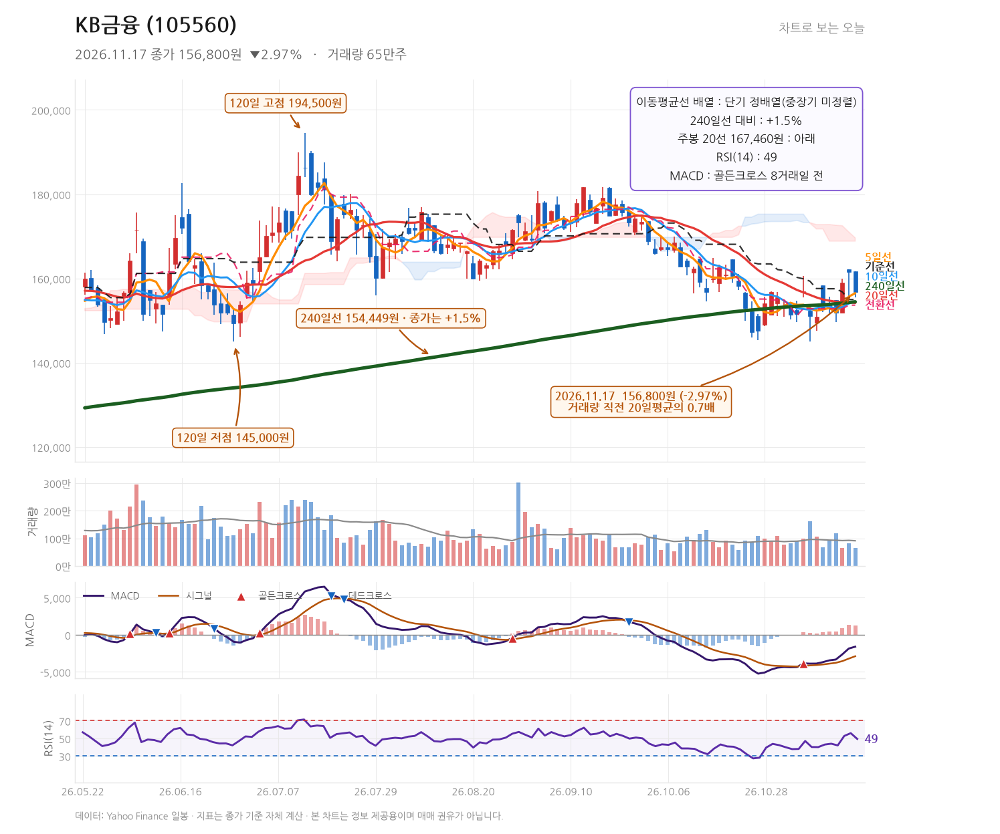
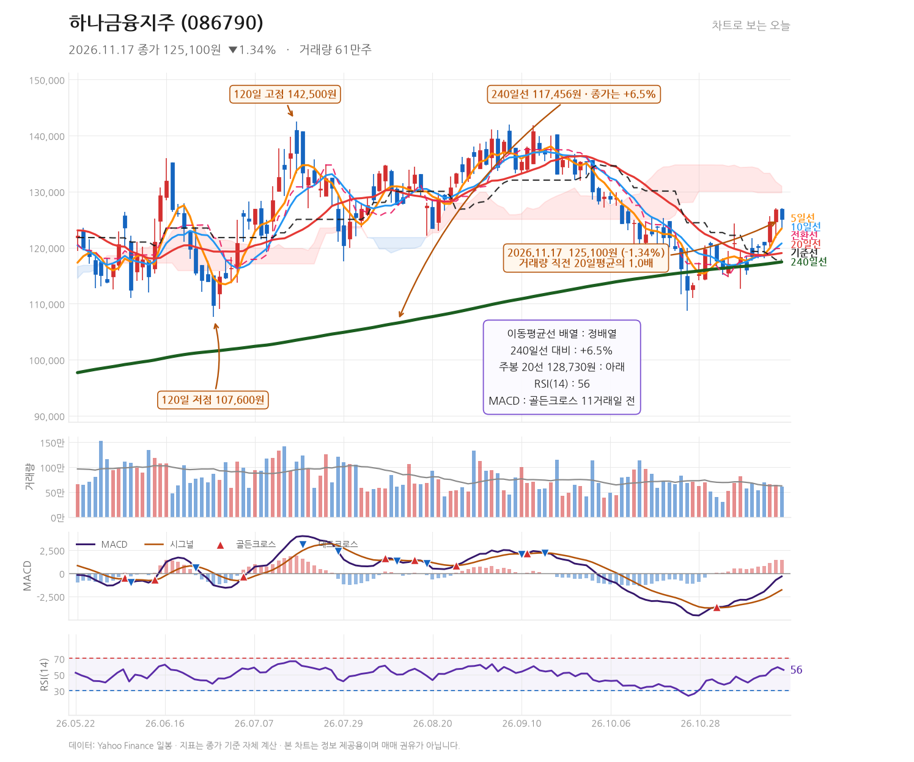

# 발행 지시서 — 2026-11-17 (묶음 글 1편)
작성: DeepSeek API · 발행: 클로드

## 공통 정보
- 블로그: https://mynote86824.tistory.com
- 카테고리: 오늘의 핫종목
- 발행 방식: **비공개** (형 확인 후 공개 전환)
- 형식: **하루 1편 묶음 글** — 종목 2개를 한 글에서 다룸
- 다룬 종목: KB금융(105560), 하나금융지주(086790)
- 발행 전 검증: 아래 「검증용 수치」를 Daum API 값과 대조, 금지 문체 확인

## 검증용 수치 (원고 작성에 사용한 값)
| 종목 | 코드 | 종가 | 등락률 | 고가 | 저가 | 거래량 |
|---|---|---|---|---|---|---|
| KB금융 | 105560 | 156,800 | -2.97% | 161,700 | 155,500 | 651,961 |
| 하나금융지주 | 086790 | 125,100 | -1.34% | 127,000 | 123,500 | 612,432 |

---

## 제목
11월 17일 KB금융 -2.97%·하나금융지주 -1.34%, 은행주 동반 약세

## 태그
#KB금융 #하나금융지주 #은행주 #차트분석 #주가전망

## 본문 HTML

<b>2026년 11월 17일 KB금융(105560)은 전일 대비 2.97% 하락한 156,800원에 마감했고, 하나금융지주(086790)는 1.34% 내린 125,100원에 거래를 마쳤습니다. 두 종목 모두 거래량이 평소 수준을 크게 벗어나지 않은 가운데 하락했습니다.</b>

이날 KB금융은 161,700원에 출발해 장중 155,500원까지 밀렸고, 하나금융지주는 126,900원에 시가를 형성한 뒤 123,500원까지 저점을 낮췄습니다. 두 종목 모두 시가 부근에서 고점을 형성하고 종가까지 밀리는 흐름을 보였습니다.

<h2>KB금융, 240일선 겨우 웃도는 위치에서 밀렸습니다</h2>

KB금융은 156,800원으로 마감하며 5일선(156,500원)과 10일선(154,560원) 위에 간신히 자리를 지켰습니다. 240일선(154,449원) 대비로는 1.5% 높은 수준입니다. 다만 주봉 20선이 167,460원에 있어 중기 흐름은 아직 아래쪽으로 눌려 있는 모습입니다.

<table style="border-collapse:collapse;width:100%;" border="1">
<tbody>
<tr><td><b>지표</b></td><td><b>값</b></td><td><b>해석</b></td></tr>
<tr><td>MACD</td><td>-1,600.0 / 시그널 -2,888.5</td><td>8거래일 전 골든크로스, 히스토그램 +1,288.6으로 개선 중</td></tr>
<tr><td>RSI(14)</td><td>49.3</td><td>중립 구간, 과매수·과매도 모두 아님</td></tr>
<tr><td>일목 전환선 / 기준선</td><td>153,650원 / 155,000원</td><td>기준선 위에 있어 단기 균형은 유지</td></tr>
<tr><td>52주 고점 대비</td><td>-19.4% (고점 194,500원)</td><td>고점 대비 조정 국면 지속</td></tr>
</tbody>
</table>

뉴스로는 국민연금이 이재근 KB금융 신임 회장 선임안에 찬성했다는 소식이 전해졌습니다. (<a href="https://n.news.naver.com/mnews/article/011/0004683250" target="_blank">서울경제</a>) 또한 KB증권이 토큰증권 기반 채권 발행·상환 실증에 나선다는 보도도 있었습니다. (<a href="https://n.news.naver.com/mnews/article/119/0003156339" target="_blank">데일리안</a>)

KB금융의 단기 지지선은 5일선과 240일선이 몰려 있는 154,000~156,500원 구간입니다. 이 아래로 내려가면 120일 저점(145,000원)까지 열려 있습니다. 반대로 반등 시에는 주봉 20선인 167,460원이 1차 저항입니다.

<h2>하나금융지주, 정배열 유지하지만 주봉 20선에 막혔습니다</h2>

하나금융지주는 125,100원으로 마감하며 5일선(123,420원)과 10일선(120,770원), 20일선(119,035원) 모두 위에 있습니다. 240일선(117,456원) 대비 6.5% 높아 중장기 정배열이 유지되고 있습니다. 다만 주봉 20선이 128,730원에 있어 이날 고점(127,000원)으로도 넘지 못했습니다.

MACD는 11거래일 전 골든크로스를 기록한 뒤 히스토그램이 +1,458.1까지 올라와 상승 모멘텀이 이어지고 있습니다. RSI는 55.8로 중립보다 약간 높은 수준입니다.

뉴스로는 금융주 비중을 늘리라는 증권가 의견이 보도되었습니다. (<a href="https://n.news.naver.com/mnews/article/215/0001273047" target="_blank">한국경제TV</a>) 다만 이는 업종 전반에 대한 코멘트로, 하나금융지주 개별 재료로 보기는 어렵습니다.

하나금융지주의 단기 지지선은 5일선(123,420원)과 이날 저점(123,500원)이 겹치는 123,000~123,500원 구간입니다. 이 아래로 내려가면 20일선(119,035원)이 다음 방어선입니다. 상단으로는 주봉 20선(128,730원)을 넘어서는지가 관건입니다.

<h2>종목별 다음 관전 포인트</h2>

KB금융은 240일선(154,449원)을 지키는지가 첫 번째 관전 포인트입니다. 이 선 아래로 종가가 내려가면 단기 정배열이 흐트러지면서 145,000원(120일 저점)까지 시야가 열릴 수 있습니다. 반등 시에는 167,460원(주봉 20선) 돌파 여부를 봐야 합니다.

하나금융지주는 5일선(123,420원) 부근에서 지지 여부를 확인하는 것이 우선입니다. 128,730원(주봉 20선)을 넘어서면 52주 고점(142,500원)까지의 상단 여지가 생기지만, 그 전까지는 123,000~128,700원 박스권 흐름을 염두에 둘 필요가 있습니다.

두 종목은 같은 은행 업종에 속하지만, 이날 각각의 차트 위치와 뉴스 재료가 달라 하나의 흐름으로 묶어 단정하기는 어렵습니다. KB금융은 240일선에 바짝 붙어 있고, 하나금융지주는 240일선 위에서 정배열을 유지하고 있다는 점에서 기술적 위치 차이가 있습니다.

※ 본 글은 기업 및 주가에 대한 정보와 분석을 제공하기 위한 목적으로 작성되었으며, 특정 금융투자상품의 매수·매도 또는 투자를 권유하지 않습니다. 
※ 본문에 포함된 실적 전망, 목표주가, 예상 EPS 등 미래 관련 수치는 시장 컨센서스 또는 전망치이며 확정된 결과가 아닙니다. 
※ 차트의 주요 가격대와 기술적 분석은 작성 시점의 데이터를 기준으로 한 분석 의견이며, 향후 주가 움직임을 보장하지 않습니다. 
※ 투자 판단은 각 투자자의 독립적인 판단과 책임에 따라 이루어져야 합니다. 
※ 작성자는 해당 종목을 보유하지 않고 있으며, 본 글은 이해관계와 무관하게 작성되었습니다.

▶ <a href="https://mynote86824.tistory.com/pages/누적-수익률" target="_blank">누적 수익률 전체 보기</a>

