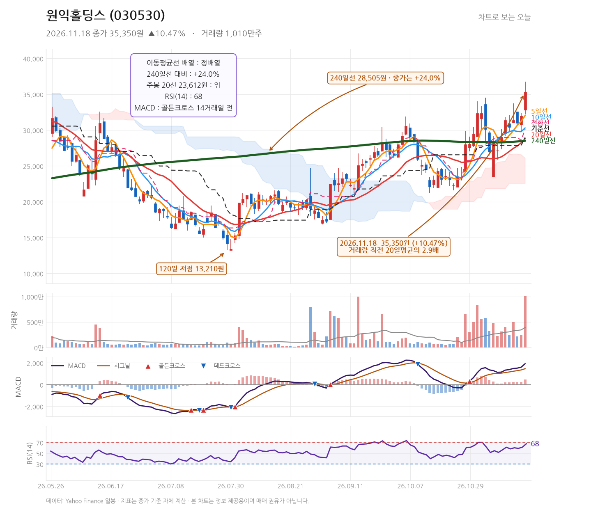
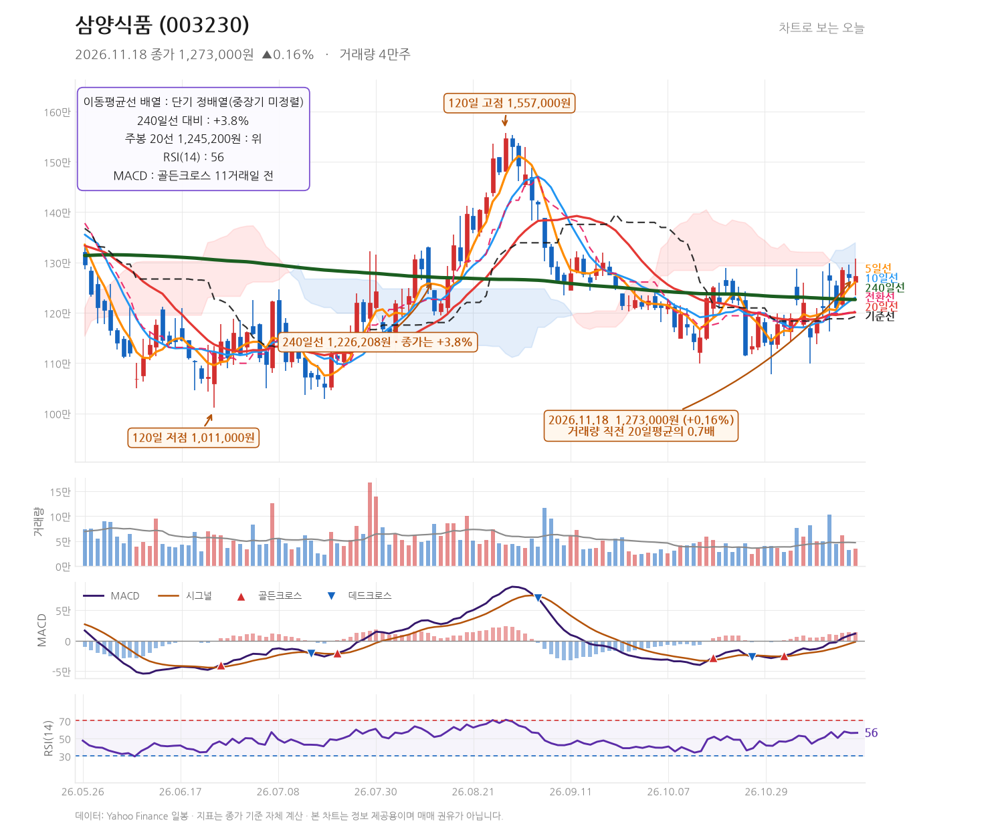

# 발행 지시서 — 2026-11-18 (묶음 글 1편)
작성: DeepSeek API · 발행: 클로드

## 공통 정보
- 블로그: https://mynote86824.tistory.com
- 카테고리: 오늘의 핫종목
- 발행 방식: **비공개** (형 확인 후 공개 전환)
- 형식: **하루 1편 묶음 글** — 종목 2개를 한 글에서 다룸
- 다룬 종목: 원익홀딩스(030530), 삼양식품(003230)
- 발행 전 검증: 아래 「검증용 수치」를 Daum API 값과 대조, 금지 문체 확인

## 검증용 수치 (원고 작성에 사용한 값)
| 종목 | 코드 | 종가 | 등락률 | 고가 | 저가 | 거래량 |
|---|---|---|---|---|---|---|
| 원익홀딩스 | 030530 | 35,350 | +10.47% | 36,750 | 32,200 | 10,105,740 |
| 삼양식품 | 003230 | 1,273,000 | +0.16% | 1,307,000 | 1,235,000 | 35,418 |

---

## 제목
11월 18일 원익홀딩스 10.47% 급등·삼양식품 0.16% 보합 마감

## 태그
#원익홀딩스 #삼양식품 #코스닥 #KOSPI #차트분석

## 본문 HTML

<b>2026년 11월 18일, 원익홀딩스(030530)는 전일 대비 10.47% 오른 35,350원에 마감했고 거래량은 직전 20거래일 평균의 2.9배를 기록했습니다. 삼양식품(003230)은 0.16% 오른 1,273,000원으로 보합권에 머물렀으며 거래량은 평균의 0.7배였습니다.</b>

<h2>원익홀딩스, 거래량 2.9배 터진 날의 캔들</h2>

이날 원익홀딩스는 32,800원에 출발해 장중 36,750원까지 올랐다가 35,350원에 마감했습니다. 시가 대비로는 7.8% 높은 수준이지만 고가 대비로는 1,400원가량 낮은 자리에서 마감한 셈입니다. 위꼬리가 짧지 않은 양봉이 나온 것입니다. 거래량은 1,010만 주를 넘어 직전 20거래일 평균의 2.9배까지 늘었습니다. 가격 상승과 거래량 증가가 동시에 나타난 점은 수급이 실제로 붙었다는 신호로 읽힙니다.

<h3>이동평균선은 어떤 순서로 놓여 있나</h3>
<table style="border-collapse:collapse;width:100%;" border="1">
<tbody>
<tr><td><b>지표</b></td><td><b>값</b></td><td><b>해석</b></td></tr>
<tr><td>5일선</td><td>32,020원</td><td>종가가 5일선 위에 위치</td></tr>
<tr><td>10일선</td><td>30,300원</td><td>단기선 위로 배열</td></tr>
<tr><td>20일선</td><td>28,798원</td><td>정배열 유지</td></tr>
<tr><td>240일선</td><td>28,505원</td><td>종가가 240일선 대비 +24.0%</td></tr>
<tr><td>MACD</td><td>1919.8 / 시그널 1461.9</td><td>14거래일 전 골든크로스, 히스토그램 458.0</td></tr>
<tr><td>RSI(14)</td><td>67.6</td><td>과매수 구간에 근접</td></tr>
</tbody>
</table>

5일선부터 240일선까지 위에서 아래로 깔끔하게 늘어선 정배열입니다. 다만 RSI가 67.6으로 70선에 가까워졌고, 120일 고점이 바로 이날 고가인 36,750원과 겹칩니다. 52주 고점은 50,600원으로 아직 30.1% 남아 있습니다.

<h3>원익홀딩스가 다시 힘을 받으려면</h3>

이날 고가 36,750원은 120일 고점과 같은 값입니다. 다음 거래일에도 이 가격대를 넘어서는지가 첫 번째 관전 포인트입니다. 반대로 조정이 나올 경우 5일선 32,020원과 이날 시가 32,800원 부근이 1차 지지선 역할을 할 수 있습니다. 이 두 가격대를 연속으로 이탈하면 이번 상승 흐름은 힘을 잃는 것으로 봐야 합니다. 일목 전환선 30,100원과 기준선 28,975원은 그보다 아래에 있는 2차 방어선입니다.

이날 관련 뉴스로는 코스피가 2%대 상승하며 5,000선을 회복했다는 시장 전체 기사와, 원익그룹 계열 케어랩스의 수익 악화를 다룬 거버넌스 기사가 눈에 띕니다. 후자는 그룹 지배구조 이슈를 다룬 것으로, 원익홀딩스 주가 급등과 직접 연결됐다고 확인된 내용은 아닙니다. (<a href="https://n.news.naver.com/mnews/article/648/0000052721" target="_blank">비즈워치</a>, <a href="https://n.news.naver.com/mnews/article/277/0005844589" target="_blank">아시아경제</a>)

<h2>삼양식품, 거래량 줄어든 채 보합권</h2>

삼양식품은 1,261,000원에 출발해 장중 1,307,000원까지 오르기도 했지만 결국 1,273,000원에 마감했습니다. 전일 종가 1,271,000원 대비 0.16% 오른 정도입니다. 거래량은 35,418주로 직전 20거래일 평균의 0.7배에 그쳤습니다. 가격도 거래량도 큰 움직임 없이 지나간 하루였습니다.

<h3>이번 주가 흐름을 결정한 재료는 무엇인가</h3>

이날 삼양식품 관련 기사 중 주가에 직접 영향을 줄 만한 것은 전인장 전 회장의 주식 매각 추진 소식입니다. 470억 원 규모로, 벌금 납부 목적이라고 보도됐습니다. 대주주 관련 매각은 물량 부담으로 해석될 수 있는 재료입니다. 또 다른 기사는 삼양식품 지주사가 평창에 풍력발전 법인을 설립하고 중장기 신사업을 추진한다는 내용입니다. 이는 단기 실적보다는 장기 방향성에 관한 소식입니다. (<a href="https://n.news.naver.com/mnews/article/001/0016450205" target="_blank">연합뉴스</a>, <a href="https://n.news.naver.com/mnews/article/018/0006412063" target="_blank">이데일리</a>)

<h3>차트가 말해주는 현재 위치</h3>

5일선 1,260,800원, 10일선 1,230,100원, 20일선 1,200,600원으로 단기선은 정배열입니다. 다만 240일선이 1,226,208원으로 20일선보다 위에 있어 중장기 배열은 아직 정리되지 않았습니다. 종가는 240일선 대비 3.8% 높은 수준입니다. MACD는 11거래일 전 골든크로스를 냈고 히스토그램이 13,540.7로 양수를 유지하고 있습니다. RSI는 56.2로 중립 구간입니다. 52주 고점 1,557,000원과는 18.2% 차이입니다.

<h3>삼양식품이 방향을 정하려면</h3>

이날 고가 1,307,000원을 다시 넘어서는지가 상승 지속 여부를 가를 첫 번째 가격대입니다. 아래로는 5일선 1,260,800원과 이날 저가 1,235,000원이 지지선 후보입니다. 20일선 1,200,600원과 일목 전환선 1,203,000원이 겹치는 구간은 좀 더 두꺼운 방어선으로 볼 수 있습니다. 이 구간을 종가 기준으로 이탈하면 단기 정배열이 흐트러지는 것으로 봐야 합니다.

참고로 삼양식품과 원익홀딩스는 업종과 사업 영역이 겹치지 않습니다. 이날 주가 흐름을 하나의 테마나 재료로 묶어 볼 근거는 확인되지 않습니다. 두 종목은 각자의 가격대만 따로 보는 것이 맞습니다.

<h2>종목별 다음 관전 포인트</h2>

원익홀딩스는 120일 고점이자 이날 고가인 36,750원을 넘어서는지, 그리고 5일선 32,020원과 시가 32,800원 부근이 지지되는지를 봐야 합니다. 삼양식품은 이날 고가 1,307,000원 돌파 여부와 5일선 1,260,800원·20일선 1,200,600원 사이에서 방향을 잡는 모습을 지켜볼 만합니다.

※ 본 글은 기업 및 주가에 대한 정보와 분석을 제공하기 위한 목적으로 작성되었으며, 특정 금융투자상품의 매수·매도 또는 투자를 권유하지 않습니다. 
※ 본문에 포함된 실적 전망, 목표주가, 예상 EPS 등 미래 관련 수치는 시장 컨센서스 또는 전망치이며 확정된 결과가 아닙니다. 
※ 차트의 주요 가격대와 기술적 분석은 작성 시점의 데이터를 기준으로 한 분석 의견이며, 향후 주가 움직임을 보장하지 않습니다. 
※ 투자 판단은 각 투자자의 독립적인 판단과 책임에 따라 이루어져야 합니다. 
※ 작성자는 해당 종목을 보유하지 않고 있으며, 본 글은 이해관계와 무관하게 작성되었습니다.

▶ <a href="https://mynote86824.tistory.com/pages/누적-수익률" target="_blank">누적 수익률 전체 보기</a>

