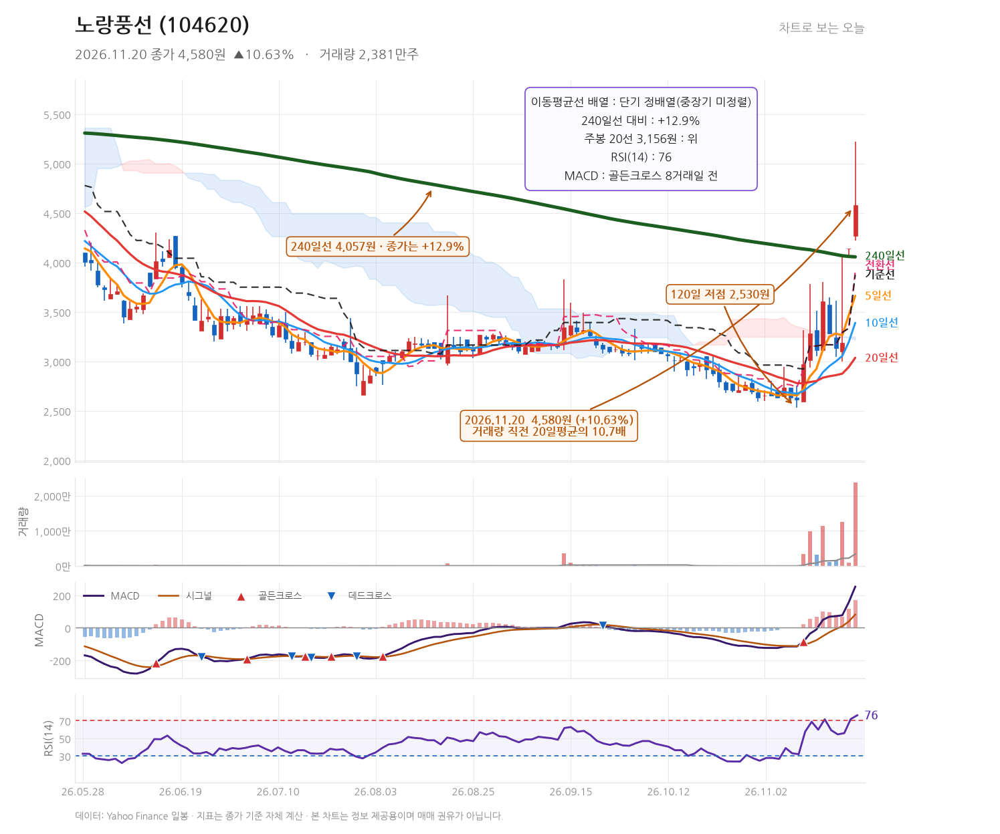
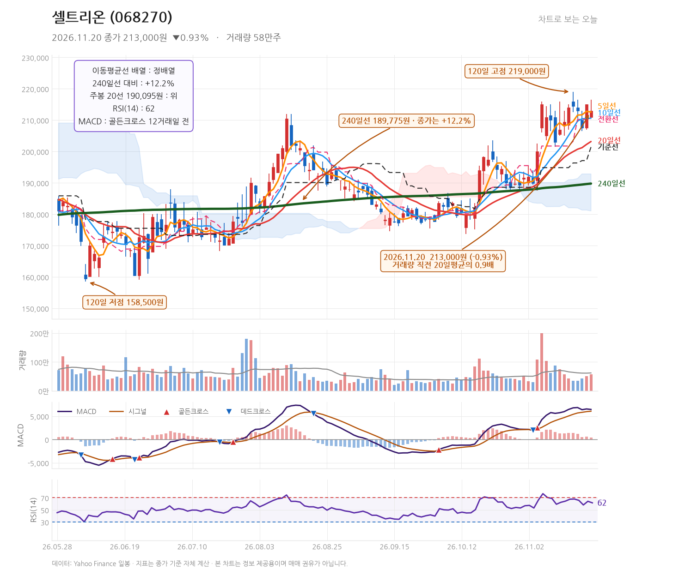

# 발행 지시서 — 2026-11-20 (묶음 글 1편)
작성: DeepSeek API · 발행: 클로드

## 공통 정보
- 블로그: https://mynote86824.tistory.com
- 카테고리: 오늘의 핫종목
- 발행 방식: **비공개** (형 확인 후 공개 전환)
- 형식: **하루 1편 묶음 글** — 종목 2개를 한 글에서 다룸
- 다룬 종목: 셀트리온(068270), 노랑풍선(104620)
- 발행 전 검증: 아래 「검증용 수치」를 Daum API 값과 대조, 금지 문체 확인

## 검증용 수치 (원고 작성에 사용한 값)
| 종목 | 코드 | 종가 | 등락률 | 고가 | 저가 | 거래량 |
|---|---|---|---|---|---|---|
| 셀트리온 | 068270 | 213,000 | -0.93% | 216,500 | 211,000 | 578,814 |
| 노랑풍선 | 104620 | 4,580 | +10.63% | 5,220 | 4,220 | 23,802,617 |

---

## 제목
11월 20일 셀트리온 213,000원 -0.93%·노랑풍선 4,580원 +10.63% 거래량 10.7배

## 태그
#셀트리온 #노랑풍선 #068270 #104620 #차트분석

## 본문 HTML

<b>2026년 11월 20일 셀트리온(068270)은 213,000원(-0.93%)에 마감했고, 노랑풍선(104620)은 4,580원(+10.63%)에 마감했습니다. 노랑풍선 거래량은 직전 20거래일 평균의 10.7배였고, 셀트리온은 0.9배였습니다.</b>

<h2>노랑풍선, 거래량 10.7배 터진 날의 캔들부터 봅니다</h2>

이날 가장 눈에 띄는 숫자는 노랑풍선의 거래량입니다. 23,802,617주로 직전 20거래일 평균의 10.7배입니다. 시가 4,265원에서 출발해 4,580원에 마감했고, 장중 고가 5,220원, 저가 4,220원을 기록했습니다. 종가 기준으로는 +10.63%지만, 고가 5,220원에서 종가 4,580원까지 약 12%가량 밀린 윗꼬리가 남았습니다.

이 캔들은 해석이 갈리는 자리입니다. 거래량이 폭발적으로 늘면서 장중 고점을 5,220원까지 찍었다는 것은 매수세가 그만큼 강했다는 뜻이고, 동시에 그 가격대에서 매도 물량도 만만치 않았다는 뜻입니다. 시가 4,265원보다 종가가 높으니 몸통은 양봉이지만, 위로 길게 뻗은 꼬리는 다음 거래일의 부담으로 남습니다.

<h2>노랑풍선의 이동평균선은 어디까지 올라와 있나</h2>

단기 이평선은 빠르게 올라섰습니다. ma5 3,663원, ma10 3,390원, ma20 3,036원으로 단기 정배열입니다. 반면 ma240은 4,057원으로, 종가 4,580원이 240일선을 약 12.9% 웃도는 자리입니다. 주봉 20선은 3,156원입니다. 120일 고점은 이날 기록한 5,220원이고, 120일 저점은 2,530원입니다. 52주 고점 6,510원과 비교하면 아직 29.6% 낮은 수준입니다.

<table style="border-collapse:collapse;width:100%;" border="1">
<tbody>
<tr><td><b>지표</b></td><td><b>값</b></td><td><b>해석</b></td></tr>
<tr><td>MACD</td><td>253.2 / 시그널 81.9 / 히스토그램 171.3</td><td>8거래일 전 골든크로스, 히스토그램 확대 중</td></tr>
<tr><td>RSI(14)</td><td>76.2</td><td>과매수 구간 진입</td></tr>
<tr><td>일목 전환선/기준선</td><td>3,908원 / 3,875원</td><td>두 선 모두 종가 아래, 단기 추세 지지</td></tr>
<tr><td>240일선</td><td>4,057원</td><td>종가가 12.9% 위, 중장기선 회복 국면</td></tr>
</tbody>
</table>

MACD는 8거래일 전 골든크로스를 낸 뒤 히스토그램이 171.3까지 벌어졌습니다. 추세 자체는 살아 있다는 신호입니다. 다만 RSI가 76.2로 과매수 구간에 들어왔고, 이날 윗꼬리가 길었다는 점을 함께 놓으면 단기 과열을 경계할 자리입니다.

<h2>노랑풍선에 붙은 재료는 무엇인가</h2>

이날 여행주 전반에 '한한령' 해빙 기대가 붙었다는 보도가 나왔습니다. 파이낸셜뉴스는 관련주 훈풍으로 여행·엔터·항공주가 강세를 보였다고 전했습니다. 디지털데일리는 겨울 일본 온천·소도시 여행 수요를 다뤘습니다. 다만 이 재료가 노랑풍선 한 종목의 실적 변화로 이어졌다는 확인은 이날 기사에는 없습니다. 테마성 수급이 붙은 날로 보는 것이 안전합니다.

노랑풍선은 여행 상품을 기획·판매하는 여행사입니다. 시가총액이 크지 않은 종목이라 테마 수급이 붙을 때 거래량이 급증하는 특성이 있습니다. 이날 10.7배 거래량도 그 연장선에서 읽어야 합니다.

<h2>노랑풍선, 다음에 볼 가격대는</h2>

위쪽으로는 이날 고가 5,220원이 첫 저항입니다. 그 위는 52주 고점 6,510원이지만 그 전에 5,000원대 중반에서 한 번 숨 고르기가 나올 수 있는 자리입니다. 아래쪽은 240일선 4,057원과 이날 시가 4,265원이 1차 지지 후보입니다. 이 두 선이 무너지면 이날 거래량 폭발이 단발성으로 끝났다는 신호로 볼 수 있습니다. 일목 전환선 3,908원, 기준선 3,875원은 그 아래 2차 방어선입니다.

<h2>셀트리온은 조용한 하루, 시총 순위 뉴스만 남았습니다</h2>

셀트리온은 이날 211,000원에 출발해 213,000원에 마감했습니다. 전일 종가 215,000원 대비 -0.93%입니다. 고가 216,500원, 저가 211,000원으로 장중 변동 폭은 약 2.6%였습니다. 거래량은 578,814주로 직전 20거래일 평균의 0.9배, 평소보다 오히려 적었습니다. 노랑풍선과 정반대로, 이날 셀트리온은 수급이 붙지 않은 하루였습니다.

<h2>셀트리온 차트는 흐트러졌나</h2>

그렇지 않습니다. ma5 212,600원, ma10 210,650원, ma20 203,185원, ma240 189,775원으로 정배열이 유지되고 있습니다. 종가는 240일선을 12.2% 웃돕니다. MACD는 6442.8, 시그널 6064.7, 히스토그램 378.2로 12거래일 전 골든크로스 이후 양수를 유지하고 있습니다. RSI는 61.6으로 과매수도 과매도도 아닌 중간 자리입니다.

다만 52주 고점 239,244원 대비로는 11.0% 낮습니다. 120일 고점 219,000원도 아직 넘지 못했습니다. 이날 종가 213,000원은 120일 고점 아래 약 2.7% 지점입니다. 일목 전환선 210,250원과 기준선 201,400원은 모두 종가 아래에 있어 단기 흐름은 지지 쪽입니다.

<h2>셀트리온에 남은 뉴스는 지수 이야기뿐</h2>

이날 셀트리온 관련 기사 중 눈에 띄는 것은 시가총액 순위 뉴스입니다. 서울경제는 코스피 시총 10위가 재편되며 셀트리온이 재진입하고 현대차가 세 계단 하락했다고 전했습니다. 같은 날 연합뉴스는 코스피가 5%대 급락해 4,800대로 후퇴, 10개월 만의 최저치를 기록했다고 보도했습니다. 주간동아는 앤스로픽 쏠림과 대중 규제 리스크 등 복합 악재로 코스피 4,900이 붕괴했다고 다뤘습니다.

지수가 5%대 빠진 날 셀트리온이 -0.93%로 버틴 것은 상대적으로 방어된 셈입니다. 다만 이는 종목 고유 재료가 아니라 지수 대비 상대 강도일 뿐입니다. 셀트리온 자체의 신규 모멘텀은 이날 기사에서 확인되지 않습니다.

<h2>셀트리온, 다음에 볼 가격대는</h2>

위쪽은 120일 고점 219,000원과 이날 고가 216,500원이 1차 저항입니다. 이 선을 거래량과 함께 넘으면 52주 고점 239,244원까지 시야가 열립니다. 아래쪽은 ma5 212,600원, 그 아래 ma10 210,650원과 일목 전환선 210,250원이 붙어 있는 210,000원 초반 구간입니다. 이 구간이 종가 기준으로 깨지면 단기 정배열이 흔들리기 시작하는 자리이고, ma20 203,185원이 그다음 방어선입니다.

<h2>두 종목을 하나의 흐름으로 묶을 수 있나</h2>

없습니다. 셀트리온은 바이오의약품을 만드는 KOSPI 대형주이고, 노랑풍선은 여행 상품을 파는 KOSDAQ 중소형주입니다. 업종도, 사업 영역도, 이날 붙은 재료도 겹치지 않습니다. 이날 셀트리온의 거래량이 평균의 0.9배로 줄어든 것과 노랑풍선이 10.7배로 터진 것은 서로 무관한 개별 사안입니다. 두 종목은 병렬로만 놓고 봐야 합니다.

정리하면 이렇습니다. 노랑풍선은 거래량 폭발과 긴 윗꼬리가 공존하는 자리라 5,220원 돌파 여부와 4,057원 240일선 사수 여부가 다음 관전 포인트입니다. 셀트리온은 조용한 하루였지만 정배열과 240일선 위 12.2%라는 위치는 유지하고 있어, 219,000원 저항 돌파와 210,000원 초반 지지 여부가 다음에 볼 지점입니다.

※ 본 글은 기업 및 주가에 대한 정보와 분석을 제공하기 위한 목적으로 작성되었으며, 특정 금융투자상품의 매수·매도 또는 투자를 권유하지 않습니다. 
※ 본문에 포함된 실적 전망, 목표주가, 예상 EPS 등 미래 관련 수치는 시장 컨센서스 또는 전망치이며 확정된 결과가 아닙니다. 
※ 차트의 주요 가격대와 기술적 분석은 작성 시점의 데이터를 기준으로 한 분석 의견이며, 향후 주가 움직임을 보장하지 않습니다. 
※ 투자 판단은 각 투자자의 독립적인 판단과 책임에 따라 이루어져야 합니다. 
※ 작성자는 해당 종목을 보유하지 않고 있으며, 본 글은 이해관계와 무관하게 작성되었습니다.

▶ <a href="https://mynote86824.tistory.com/pages/누적-수익률">누적 수익률 전체 보기</a>

