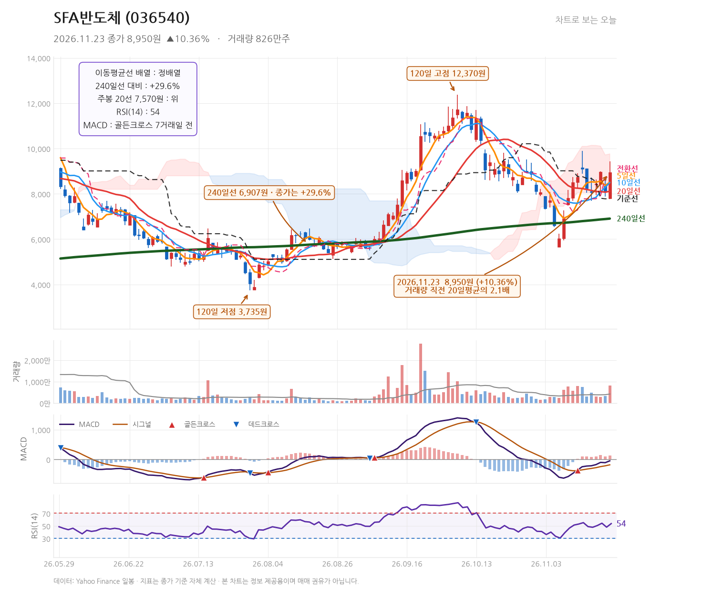
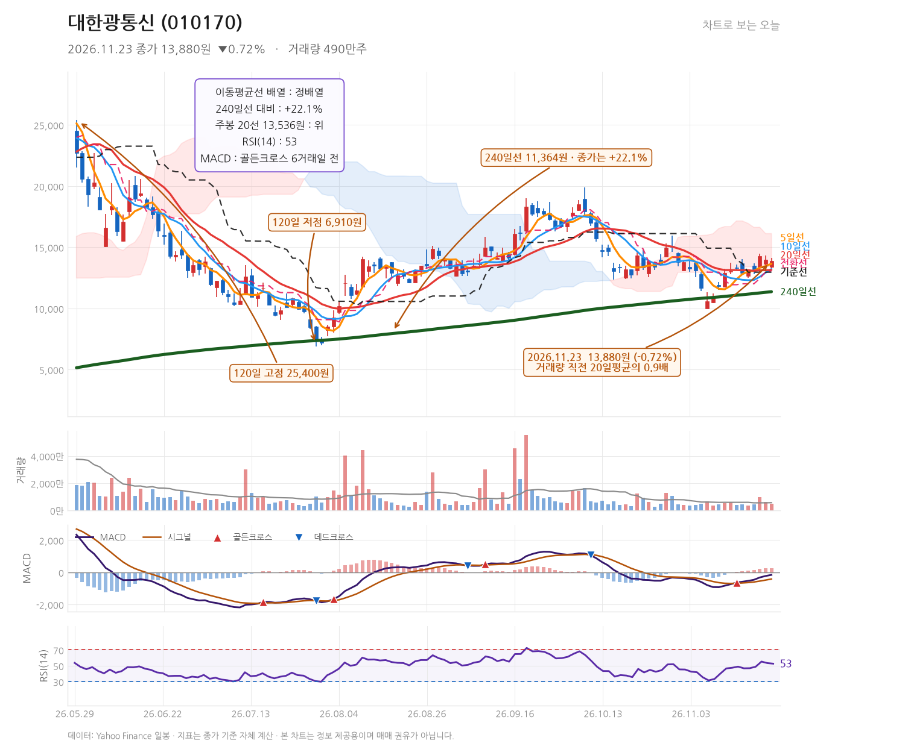

# 발행 지시서 — 2026-11-23 (묶음 글 1편)
작성: DeepSeek API · 발행: 클로드

## 공통 정보
- 블로그: https://mynote86824.tistory.com
- 카테고리: 오늘의 핫종목
- 발행 방식: **비공개** (형 확인 후 공개 전환)
- 형식: **하루 1편 묶음 글** — 종목 2개를 한 글에서 다룸
- 다룬 종목: SFA반도체(036540), 대한광통신(010170)
- 발행 전 검증: 아래 「검증용 수치」를 Daum API 값과 대조, 금지 문체 확인

## 검증용 수치 (원고 작성에 사용한 값)
| 종목 | 코드 | 종가 | 등락률 | 고가 | 저가 | 거래량 |
|---|---|---|---|---|---|---|
| SFA반도체 | 036540 | 8,950 | +10.36% | 9,430 | 7,780 | 8,325,555 |
| 대한광통신 | 010170 | 13,880 | -0.72% | 14,110 | 13,290 | 4,903,341 |

---

## 제목
2026년 11월 23일 SFA반도체 10.36% 급등, 대한광통신은 0.72% 소폭 하락

## 태그
#SFA반도체 #대한광통신 #코스닥 #차트분석 #주식블로그

## 본문 HTML

<b>2026년 11월 23일, SFA반도체(036540)는 전일 대비 10.36% 오른 8,950원에 마감했고 거래량은 직전 20거래일 평균의 2.1배였습니다. 대한광통신(010170)은 0.72% 내린 13,880원에 마감했으며 거래량은 평균의 0.9배였습니다.</b>

<h2>SFA반도체, 거래량 2.1배 동반한 10%대 상승</h2>

SFA반도체는 이날 7,790원에 출발해 장중 9,430원까지 올랐고, 8,950원에 마감했습니다. 전일 종가 8,110원 대비 10.36% 상승입니다. 거래량은 8,325,555주로 직전 20거래일 평균의 2.1배 수준을 기록했습니다.

이동평균선은 5일선 8,508원, 10일선 8,494원, 20일선 8,113원, 240일선 6,907원으로 정배열을 보이고 있습니다. 종가는 240일선 대비 29.6% 높은 수준입니다. MACD는 -48.2, 시그널 -182.3, 히스토그램 134.1로 7거래일 전 골든크로스가 발생한 상태를 유지하고 있습니다. RSI(14)는 53.6입니다.

일목균형표 전환선은 8,800원, 기준선은 7,780원입니다. 이날 시가가 7,790원으로 기준선 부근에서 출발해 종가가 전환선 위로 올라선 점이 눈에 띕니다. 52주 고점은 12,370원, 저점은 3,735원이며 현재가는 고점 대비 27.6% 낮은 위치입니다.

이날 상승은 최근 20거래일 평균보다 두 배 이상 많은 거래량을 동반했다는 점에서 단순 반등과 구분됩니다. 다만 장중 고가 9,430원에서 종가 8,950원으로 밀린 폭이 480원가량으로, 윗꼬리가 짧지 않게 남았습니다. 다음 거래에서 9,430원 돌파 여부와 8,800원(전환선) 지지 여부를 함께 볼 필요가 있습니다.

<h2>대한광통신, 보합권 등락 속 거래량은 평균 아래</h2>

대한광통신은 13,390원에 출발해 14,110원까지 올랐으나 13,880원에 마감했습니다. 전일 종가 13,980원 대비 0.72% 하락입니다. 거래량은 4,903,341주로 직전 20거래일 평균의 0.9배에 그쳤습니다.

이동평균선은 5일선 13,650원, 10일선 13,221원, 20일선 13,146원, 240일선 11,364원으로 정배열입니다. 종가는 240일선 대비 22.1% 위에 있습니다. MACD는 -160.2, 시그널 -418.9, 히스토그램 258.7로 6거래일 전 골든크로스 이후 히스토그램이 확대되는 흐름입니다. RSI(14)는 52.6입니다.

일목균형표 전환선 13,070원, 기준선 12,960원 모두 현재가 아래에 있어 단기 균형은 유지되고 있습니다. 다만 52주 고점 31,500원 대비로는 55.9% 낮은 수준이고, 120일 고점 25,400원과도 거리가 있습니다. 이날 음봉 마감이지만 낙폭이 1% 미만이고 거래량이 평균을 밑돌았다는 점에서 추세 훼손으로 보기는 이릅니다.

<h2>종목별 다음 관전 포인트</h2>

SFA반도체는 이날 상승분을 지키는지가 첫 번째 관전 포인트입니다. 8,800원(일목 전환선)과 8,508원(5일선)이 단기 지지 후보이고, 9,430원(당일 고가) 돌파 시 120일 고점 12,370원까지의 되돌림 구간이 열립니다. 반대로 7,780원(기준선·당일 저가) 아래로 내려가면 이날 상승을 되돌림으로 판단할 근거가 생깁니다.

대한광통신은 13,650원(5일선)과 13,536원(주봉 20선)이 겹치는 구간의 지지 여부가 중요합니다. 이 선 아래로 종가가 내려오면 단기 정배열이 흔들릴 수 있습니다. 위쪽으로는 이날 고가 14,110원과 120일 고점 25,400원 사이에 뚜렷한 저항대가 없어, 거래량이 평균을 웃도는 날 14,110원을 넘는지가 다음 확인 지점입니다.

두 종목은 업종과 사업 영역이 겹치지 않고, 이날 확인된 공통 재료나 뉴스도 없습니다. 하나의 흐름으로 묶어 볼 근거가 없어 각각의 가격대만 병렬로 정리했습니다.

※ 본 글은 기업 및 주가에 대한 정보와 분석을 제공하기 위한 목적으로 작성되었으며, 특정 금융투자상품의 매수·매도 또는 투자를 권유하지 않습니다. 
※ 본문에 포함된 실적 전망, 목표주가, 예상 EPS 등 미래 관련 수치는 시장 컨센서스 또는 전망치이며 확정된 결과가 아닙니다. 
※ 차트의 주요 가격대와 기술적 분석은 작성 시점의 데이터를 기준으로 한 분석 의견이며, 향후 주가 움직임을 보장하지 않습니다. 
※ 투자 판단은 각 투자자의 독립적인 판단과 책임에 따라 이루어져야 합니다. 
※ 작성자는 해당 종목을 보유하지 않고 있으며, 본 글은 이해관계와 무관하게 작성되었습니다.

▶ <a href="https://mynote86824.tistory.com/pages/누적-수익률">누적 수익률 전체 보기</a>

