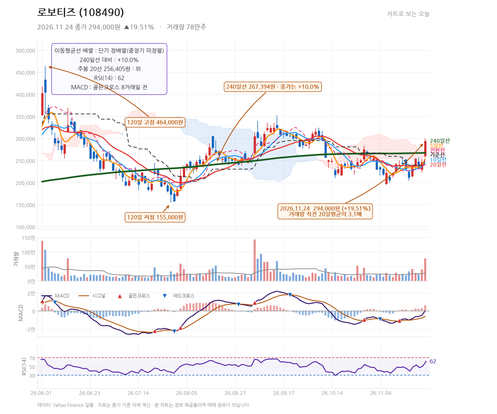
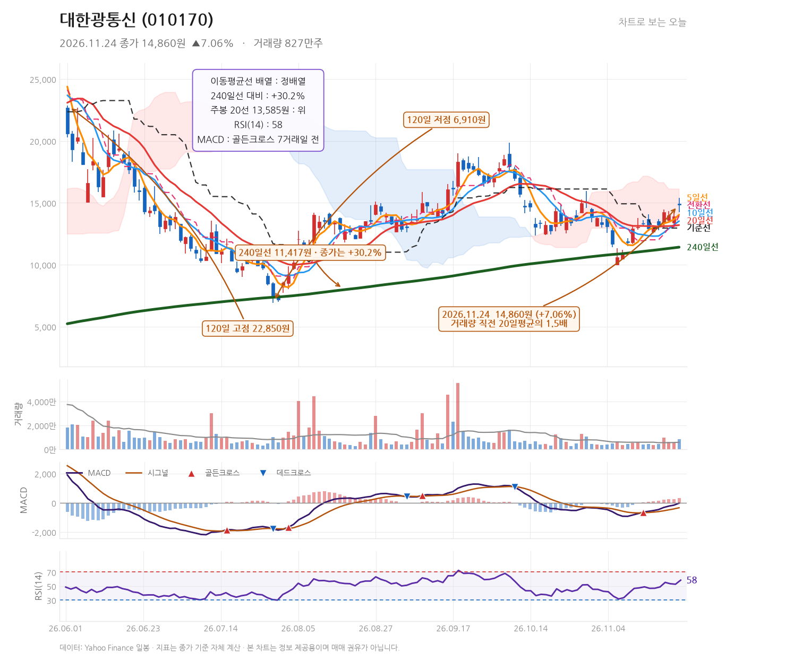

# 발행 지시서 — 2026-11-24 (묶음 글 1편)
작성: DeepSeek API · 발행: 클로드

## 공통 정보
- 블로그: https://mynote86824.tistory.com
- 카테고리: 오늘의 핫종목
- 발행 방식: **비공개** (형 확인 후 공개 전환)
- 형식: **하루 1편 묶음 글** — 종목 2개를 한 글에서 다룸
- 다룬 종목: 로보티즈(108490), 대한광통신(010170)
- 발행 전 검증: 아래 「검증용 수치」를 Daum API 값과 대조, 금지 문체 확인

## 검증용 수치 (원고 작성에 사용한 값)
| 종목 | 코드 | 종가 | 등락률 | 고가 | 저가 | 거래량 |
|---|---|---|---|---|---|---|
| 로보티즈 | 108490 | 294,000 | +19.51% | 300,000 | 256,500 | 779,407 |
| 대한광통신 | 010170 | 14,860 | +7.06% | 15,400 | 14,230 | 8,259,234 |

---

## 제목
11월 24일 로보티즈 19.51% 급등·대한광통신 7.06% 상승, 거래량 각 3.1배·1.5배

## 태그
#로보티즈 #대한광통신 #코스닥 #차트분석 #거래량급증

## 본문 HTML

<b>2026년 11월 24일 코스닥 시장에서 로보티즈(108490)가 종가 294,000원으로 전일 대비 19.51% 상승했고 거래량은 직전 20거래일 평균의 3.1배를 기록했습니다. 대한광통신(010170)은 종가 14,860원으로 7.06% 올랐으며 거래량은 평균의 1.5배였습니다.</b>

<h2>로보티즈, 하루 만에 240일선을 되찾은 캔들</h2>

로보티즈는 이날 260,500원에 출발해 장중 256,500원까지 밀렸다가 300,000원까지 치솟은 뒤 294,000원에 마감했습니다. 전일 종가 246,000원과 비교하면 하루 만에 48,000원이 오른 셈입니다. 눈에 띄는 것은 거래량입니다. 779,407주로 직전 20거래일 평균의 3.1배가 터졌습니다. 가격 상승과 거래량 증가가 같은 방향으로 나온 날입니다.

<h3>이날 상승이 기술적으로 어디까지 되돌린 것인가</h3>

가장 중요한 변화는 240일선(267,394원) 회복입니다. 종가 기준으로 240일선 대비 +10.0% 위치까지 올라섰습니다. 5일선 253,400원, 10일선 243,450원, 20일선 240,700원이 모두 종가 아래에 깔리면서 단기 정배열은 갖춰졌지만, 중장기 이평선과의 정렬은 아직 완성되지 않은 상태입니다. 일목 전환선 252,000원과 기준선 247,500원도 종가가 모두 상회합니다.

MACD는 71.1, 시그널은 -6,233.1로 히스토그램이 +6,304.3을 가리킵니다. 8거래일 전 골든크로스가 발생한 뒤 상승 모멘텀이 이어지고 있다는 뜻입니다. RSI(14)는 61.8로 과매수 구간에 들어서지 않았습니다. 52주 고점 464,000원 대비로는 아직 -36.6% 낮은 자리입니다.

<h3>이날 뉴스는 시장 전체 이야기였다</h3>

로보티즈 관련 개별 뉴스는 확인되지 않습니다. 이날 보도된 기사들은 코스피가 6%대 급등하며 5,000선을 탈환했다는 시장 전체 내용입니다. 젠슨 황 관련 재료가 지수 전반을 밀어 올렸다는 보도입니다. <a href="https://n.news.naver.com/mnews/article/374/0000545658" target="_blank">SBS Biz</a>, <a href="https://n.news.naver.com/mnews/article/629/0000555164" target="_blank">더팩트</a>, <a href="https://n.news.naver.com/mnews/article/138/0002249755" target="_blank">디지털데일리</a> 모두 같은 맥락입니다. 종목 고유의 재료로 19%대 상승을 설명하기는 어렵고, 수급이 몰린 날로 보는 편이 정확합니다.

<h3>로보티즈 다음 관전 포인트</h3>

첫 번째 기준선은 240일선 267,394원입니다. 이날 종가가 이 위에 안착했으니, 조정이 나오더라도 이 선을 지키는지가 추세 유지의 갈림길입니다. 두 번째는 이날 고가 300,000원입니다. 장중 한 번 찍고 밀린 자리라 다음 시도에서 이 가격을 종가로 넘기는지가 관건입니다. 반대로 5일선 253,400원과 전환선 252,000원이 겹치는 구간을 종가로 이탈하면 이날 상승분의 절반 이상을 반납하는 흐름이므로 추세 판단을 다시 해야 합니다. 52주 고점 464,000원까지는 여전히 거리가 멀어, 단기 급등을 추세 전환으로 단정하기는 이릅니다.

<h2>대한광통신, 시가 아래로 밀린 채 마감한 7% 상승</h2>

대한광통신은 14,930원에 출발해 15,400원까지 올랐지만 종가는 14,860원으로 시가보다 낮게 끝났습니다. 상승률은 7.06%로 플러스지만, 장중 고가 대비로는 540원 밀린 채 마감한 것입니다. 거래량은 8,259,234주로 직전 20거래일 평균의 1.5배였습니다. 로보티즈의 3.1배와 비교하면 수급 강도는 상대적으로 약한 편입니다.

<h3>정배열은 완성됐지만 위쪽에 부담이 남아 있다</h3>

이평선은 5일선 14,036원, 10일선 13,525원, 20일선 13,204원, 240일선 11,417원으로 완전한 정배열입니다. 종가는 240일선 대비 +30.2% 위에 있습니다. 주봉 20선 13,585원도 종가 아래입니다. 일목 전환선 13,960원과 기준선 12,960원 역시 모두 하회하지 않았습니다.

다만 MACD는 -26.8로 아직 0선 아래입니다. 시그널 -340.5보다는 위에 있어 히스토그램이 +313.6을 기록 중이고, 7거래일 전 골든크로스가 나온 상태입니다. RSI(14)는 58.4입니다. 52주 고점 31,500원 대비로는 -52.8%, 120일 고점 22,850원과 비교해도 절반 수준을 회복하지 못한 자리입니다. 120일 저점이 6,910원이었으니, 저점에서 두 배 이상 오른 뒤 고점 대비로는 여전히 크게 낮은, 변동성이 큰 구간에 서 있습니다.

<h3>대한광통신 다음 관전 포인트</h3>

이날 고가 15,400원이 첫 번째 저항입니다. 종가가 시가를 밑돈 만큼, 다음 거래에서 이 고가를 다시 넘어서는지가 단기 방향을 가릅니다. 지지 쪽에서는 5일선 14,036원과 전환선 13,960원이 거의 겹치는 14,000원 부근이 1차선입니다. 이 구간을 종가로 깨면 10일선 13,525원과 주봉 20선 13,585원이 겹치는 13,500원대까지 열어둬야 합니다. 240일선 11,417원은 추세가 완전히 무효화되는 마지막 기준선으로 보는 것이 합리적입니다.

<h2>두 종목을 함께 볼 때 유의할 점</h2>

로보티즈는 로봇 액추에이터·모듈을 만드는 회사이고, 대한광통신은 광섬유·광케이블을 생산하는 회사입니다. 업종과 사업 영역이 겹치지 않고, 이날 확인된 뉴스에서도 두 회사를 연결하는 재료는 없습니다. 로보티즈 관련 보도는 시장 지수 이야기뿐이고 대한광통신은 관련 뉴스 자체가 확인되지 않습니다. 따라서 두 종목의 상승을 하나의 테마나 공통 원인으로 묶어 해석할 근거는 없습니다. 각각의 차트와 수급만 따로 보는 것이 맞습니다.

거래량이 평소보다 많았다는 점은 두 종목 모두에 해당하지만, 이는 종목을 선정한 기준 자체이므로 공통점으로 볼 수는 없습니다. 로보티즈는 240일선 회복과 3.1배 거래량이 맞물린 자리, 대한광통신은 정배열 위에서 윗꼬리를 남긴 자리로, 대응 논리가 서로 다릅니다.

※ 본 글은 기업 및 주가에 대한 정보와 분석을 제공하기 위한 목적으로 작성되었으며, 특정 금융투자상품의 매수·매도 또는 투자를 권유하지 않습니다. 
※ 본문에 포함된 실적 전망, 목표주가, 예상 EPS 등 미래 관련 수치는 시장 컨센서스 또는 전망치이며 확정된 결과가 아닙니다. 
※ 차트의 주요 가격대와 기술적 분석은 작성 시점의 데이터를 기준으로 한 분석 의견이며, 향후 주가 움직임을 보장하지 않습니다. 
※ 투자 판단은 각 투자자의 독립적인 판단과 책임에 따라 이루어져야 합니다. 
※ 작성자는 해당 종목을 보유하지 않고 있으며, 본 글은 이해관계와 무관하게 작성되었습니다.

▶ <a href="https://mynote86824.tistory.com/pages/누적-수익률" target="_blank">누적 수익률 전체 보기</a>

