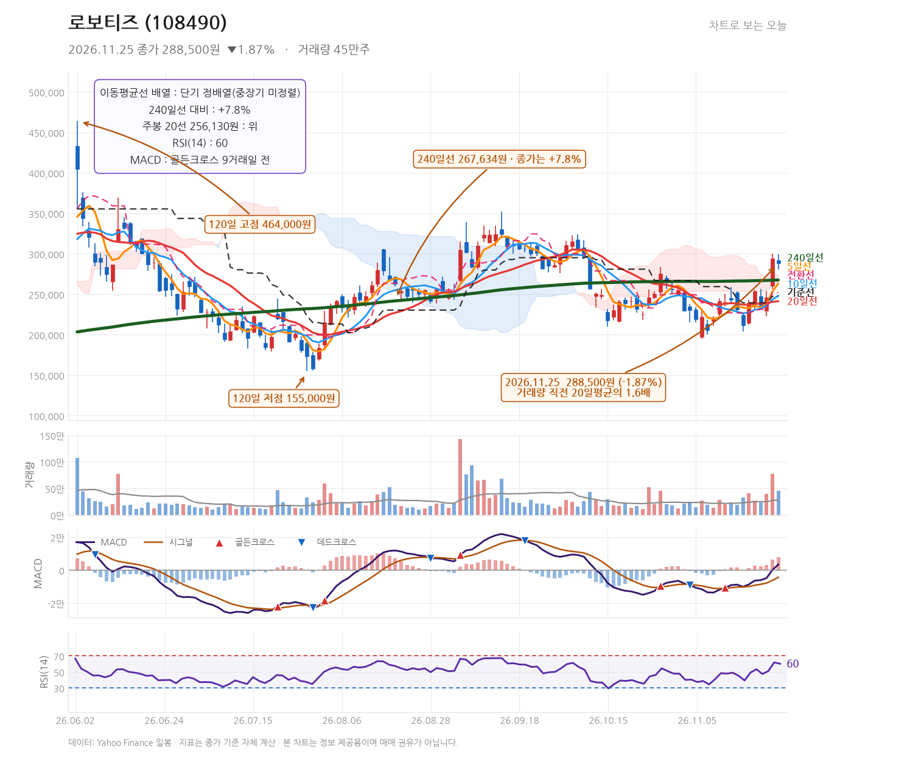
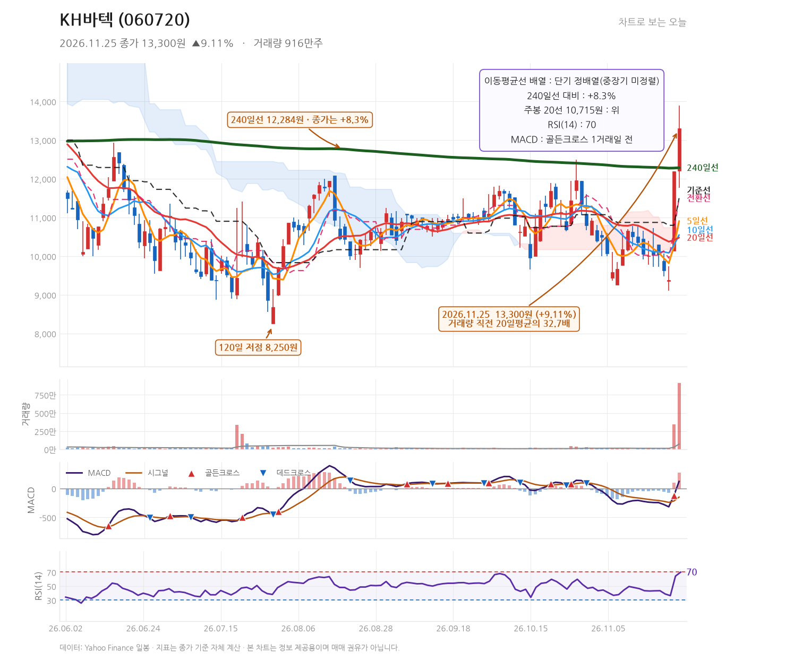

# 발행 지시서 — 2026-11-25 (묶음 글 1편)
작성: DeepSeek API · 발행: 클로드

## 공통 정보
- 블로그: https://mynote86824.tistory.com
- 카테고리: 오늘의 핫종목
- 발행 방식: **비공개** (형 확인 후 공개 전환)
- 형식: **하루 1편 묶음 글** — 종목 2개를 한 글에서 다룸
- 다룬 종목: 로보티즈(108490), KH바텍(060720)
- 발행 전 검증: 아래 「검증용 수치」를 Daum API 값과 대조, 금지 문체 확인

## 검증용 수치 (원고 작성에 사용한 값)
| 종목 | 코드 | 종가 | 등락률 | 고가 | 저가 | 거래량 |
|---|---|---|---|---|---|---|
| 로보티즈 | 108490 | 288,500 | -1.87% | 299,500 | 280,500 | 452,542 |
| KH바텍 | 060720 | 13,300 | +9.11% | 13,890 | 11,770 | 9,077,227 |

---

## 제목
11월 25일 로보티즈 1.87% 하락·KH바텍 9.11% 급등, 거래량 32.7배 폭증

## 태그
#로보티즈 #KH바텍 #코스닥 #차트분석 #거래량급증

## 본문 HTML

<b>2026년 11월 25일 코스닥에서 로보티즈(108490)는 전일 대비 1.87% 내린 288,500원에 마감했고, KH바텍(060720)은 9.11% 오른 13,300원에 장을 마쳤습니다. KH바텍 거래량은 직전 20거래일 평균의 32.7배로 폭증한 반면, 로보티즈는 1.6배 수준이었습니다.</b>

<h3>로보티즈, 29만 원대 시가에도 윗꼬리 남기고 밀린 이유는</h3>

로보티즈는 이날 292,000원에 출발해 장중 299,500원까지 올랐지만, 종가 288,500원으로 마감하며 전일 종가(294,000원)를 밑돌았습니다. 고가 대비 11,000원가량을 반납한 윗꼬리 캔들입니다. 거래량은 452,542주로 직전 20거래일 평균의 1.6배였습니다.

<table style="border-collapse:collapse;width:100%;" border="1">
<tbody>
<tr><td><b>지표</b></td><td><b>값</b></td><td><b>해석</b></td></tr>
<tr><td>5일선</td><td>263,200원</td><td>종가가 5일선 위에 위치</td></tr>
<tr><td>20일선</td><td>241,350원</td><td>단기 정배열 유지</td></tr>
<tr><td>240일선</td><td>267,634원</td><td>종가가 240일선 대비 +7.8%</td></tr>
<tr><td>MACD</td><td>3452.6 / 시그널 -4296.0</td><td>9거래일 전 골든크로스, 히스토그램 +7748.6</td></tr>
<tr><td>RSI(14)</td><td>60.2</td><td>과열권 진입 전 중립 상단</td></tr>
</tbody>
</table>

일목 전환선 252,000원과 기준선 247,500원 모두 종가 아래에 있어 단기 흐름 자체는 훼손되지 않았습니다. 다만 52주 고점 464,000원 대비로는 -37.8% 수준으로, 120일 고점(464,000원)과 저점(155,000원) 사이 넓은 변동성 구간의 중상단에 머물고 있습니다.

이날 로보티즈 관련 개별 공시나 실적 뉴스는 확인되지 않았습니다. 다올자산운용이 '피지컬 AI·채권' 결합 로봇 밸류체인 펀드를 출시했다는 소식이 전해졌지만, 이는 펀드 출시 자체에 대한 보도로 로보티즈의 실적이나 수주와 직접 연결되는 내용은 아닙니다. 같은 날 코스피가 4600선으로 후퇴하고 외국인이 1.9조 원 순매도를 기록했다는 시황 보도가 있었던 만큼, 수급 전반의 경계감 속에 윗꼬리를 남긴 흐름으로 보입니다.

<h3>KH바텍, 32.7배 거래량에 52주 고점의 3분의 2까지 회복</h3>

KH바텍은 이날 12,210원에 출발해 장중 11,770원까지 밀렸다가 13,890원까지 치솟았고, 종가 13,300원으로 전일 대비 9.11% 상승했습니다. 거래량은 9,077,227주로 직전 20거래일 평균의 32.7배에 달했습니다. 저가에서 고가까지 하루 변동 폭이 2,120원(약 18%)에 이르는 긴 캔들이 만들어졌습니다.

이날 급등의 배경으로는 로봇 부품주 관련 보도가 함께 나왔습니다. 한국경제는 '삼성 로봇에 올라탈 기업은…로봇 부품주 옥석 가리기 시작'이라는 제목으로 로봇 부품주를 조명했고, SBS Biz는 젠슨 황 엔비디아 CEO 복귀 소식에 반도체주가 급등했다는 기업 이슈를 전했습니다. 다만 이들 기사가 KH바텍의 개별 수주나 실적을 직접 언급한 것인지는 기사 내용만으로 확인되지 않습니다. 거래량이 32.7배로 터진 만큼 재료의 성격을 확인하기 전까지는 수급 주도의 급등으로 해석하는 편이 안전합니다.

차트 위치를 보면 240일선이 12,284원으로, 이날 종가 13,300원은 240일선을 8.3% 웃돌며 처음으로 이 선을 뚜렷하게 넘어섰습니다. 5일선 10,906원, 10일선 10,547원, 20일선 10,478원으로 단기 정배열이 뚜렷하고, MACD는 1거래일 전 골든크로스가 발생해 히스토그램이 +270.9를 가리키고 있습니다. RSI(14)는 69.9로 과매수 경계선(70)에 바짝 붙어 있습니다. 52주 고점 19,960원 대비로는 -33.4% 수준이며, 120일 저점은 8,250원입니다.

<h3>종목별 다음 관전 포인트</h3>

<b>로보티즈</b>는 5일선 263,200원과 일목 전환선 252,000원이 1차 지지 후보입니다. 이 두 선을 종가 기준으로 내준다면 이번 반등 흐름이 무효화되는 것으로 볼 수 있습니다. 위쪽으로는 이날 고가 299,500원과 30만 원선 돌파 여부, 그리고 52주 고점(464,000원)까지의 복원 경로에서 240일선 267,634원 위에서 버티는지가 관건입니다.

<b>KH바텍</b>은 240일선 12,284원이 되돌림 시 1차 방어선입니다. 급등 하루 만에 240일선을 크게 웃돈 만큼, 조정이 나올 경우 이 선에서 지지되는지가 추세 지속의 분수령입니다. 위쪽으로는 이날 고가 13,890원 돌파 여부와 52주 고점 19,960원까지의 중간 저항대가 관찰 지점입니다. RSI가 69.9로 과열권 문턱에 있어 단기 속도 조절 가능성도 함께 봐야 합니다.

두 종목은 로보티즈가 로봇 액추에이터, KH바텍이 휴대폰·로봇용 부품 사업을 영위하는 것으로 알려져 있으나, 이날 확인된 뉴스와 데이터만으로는 하나의 재료나 수급 흐름으로 묶어 설명할 근거가 부족합니다. 업종과 사업 영역이 완전히 겹치지 않아 병렬로 정리하는 것이 정확합니다.

※ 본 글은 기업 및 주가에 대한 정보와 분석을 제공하기 위한 목적으로 작성되었으며, 특정 금융투자상품의 매수·매도 또는 투자를 권유하지 않습니다. 
※ 본문에 포함된 실적 전망, 목표주가, 예상 EPS 등 미래 관련 수치는 시장 컨센서스 또는 전망치이며 확정된 결과가 아닙니다. 
※ 차트의 주요 가격대와 기술적 분석은 작성 시점의 데이터를 기준으로 한 분석 의견이며, 향후 주가 움직임을 보장하지 않습니다. 
※ 투자 판단은 각 투자자의 독립적인 판단과 책임에 따라 이루어져야 합니다. 
※ 작성자는 해당 종목을 보유하지 않고 있으며, 본 글은 이해관계와 무관하게 작성되었습니다.

▶ <a href="https://mynote86824.tistory.com/pages/누적-수익률">누적 수익률 전체 보기</a>

