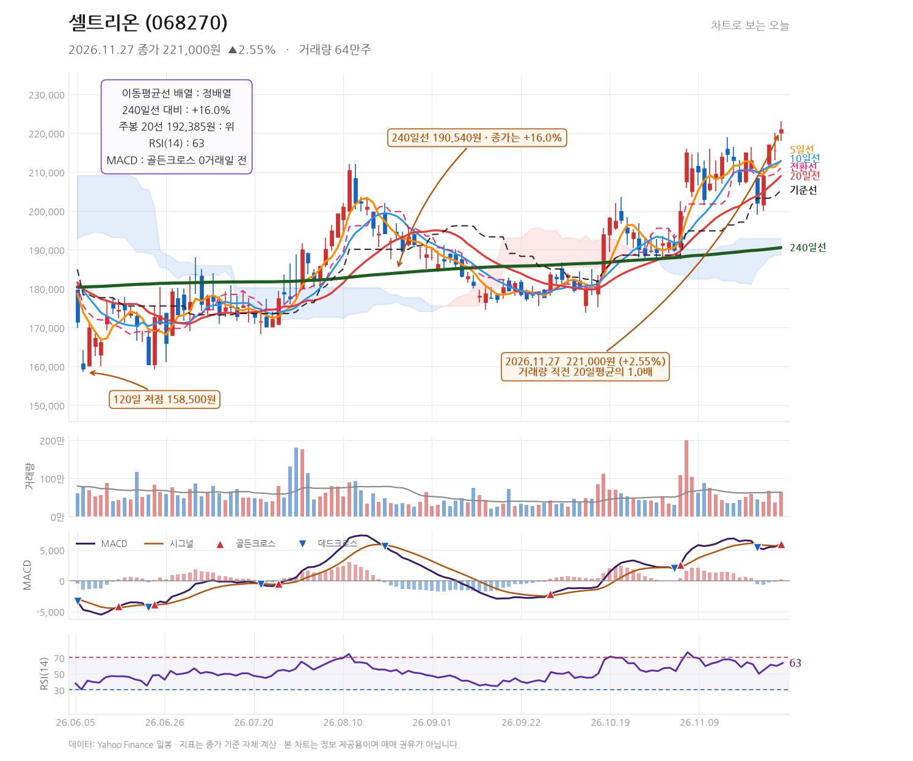
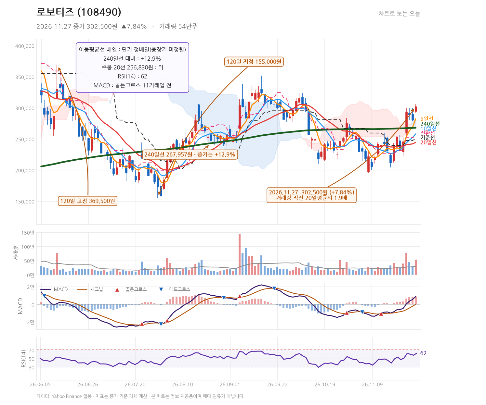

# 발행 지시서 — 2026-11-27 (묶음 글 1편)
작성: DeepSeek API · 발행: 클로드

## 공통 정보
- 블로그: https://mynote86824.tistory.com
- 카테고리: 오늘의 핫종목
- 발행 방식: **비공개** (형 확인 후 공개 전환)
- 형식: **하루 1편 묶음 글** — 종목 2개를 한 글에서 다룸
- 다룬 종목: 셀트리온(068270), 로보티즈(108490)
- 발행 전 검증: 아래 「검증용 수치」를 Daum API 값과 대조, 금지 문체 확인

## 검증용 수치 (원고 작성에 사용한 값)
| 종목 | 코드 | 종가 | 등락률 | 고가 | 저가 | 거래량 |
|---|---|---|---|---|---|---|
| 셀트리온 | 068270 | 221,000 | +2.55% | 223,000 | 218,000 | 644,472 |
| 로보티즈 | 108490 | 302,500 | +7.84% | 306,000 | 292,500 | 534,982 |

---

## 제목
11월 27일 셀트리온 +2.55%·로보티즈 +7.84%, 로보티즈 거래량 1.9배

## 태그
#셀트리온 #로보티즈 #068270 #108490 #차트분석 #코스피 #코스닥

## 본문 HTML

<b>2026년 11월 27일 셀트리온(068270)은 221,000원(+2.55%)에 마감했고 거래량은 직전 20거래일 평균의 1.0배였습니다. 로보티즈(108490)는 302,500원(+7.84%)에 마감하며 거래량이 평균의 1.9배를 기록했습니다.</b>

<h3>셀트리온, 120일 고점을 종가로 넘어섰나</h3>

셀트리온은 이날 220,000원에 출발해 218,000원까지 밀렸다가 다시 223,000원까지 올랐고, 221,000원에 마감했습니다. 전일 종가 215,500원 대비 +2.55%입니다. 눈에 띄는 것은 120일 고점입니다. 데이터상 120일 고점이 223,000원인데, 이날 고가가 정확히 223,000원입니다. 장중 고점과 120일 고점이 같다는 뜻이고, 종가(221,000원)는 그 아래에서 마감했습니다.

<table style="border-collapse:collapse;width:100%;" border="1">
<tbody>
<tr><td><b>지표</b></td><td><b>값</b></td><td><b>해석</b></td></tr>
<tr><td>MA5</td><td>212,900원</td><td>종가가 5일선 위에 위치</td></tr>
<tr><td>MA20</td><td>208,945원</td><td>20일선과 12,000원 이상 이격</td></tr>
<tr><td>MA240</td><td>190,540원</td><td>240일선 대비 +16.0%</td></tr>
<tr><td>MACD</td><td>5,947.8 / 시그널 5,717.8</td><td>당일 골든크로스 발생</td></tr>
<tr><td>RSI(14)</td><td>63.3</td><td>과매수(70) 아래</td></tr>
<tr><td>일목 전환선 / 기준선</td><td>211,000원 / 205,250원</td><td>전환선이 기준선 위</td></tr>
</tbody>
</table>

이평선은 5일선(212,900원) &gt; 10일선(212,750원) &gt; 20일선(208,945원) &gt; 240일선(190,540원) 순의 정배열입니다. MACD는 시그널을 당일(0거래일 전) 상향 돌파했고 히스토그램은 +230.0입니다. 다만 52주 고점 239,244원과 비교하면 아직 -7.6% 아래입니다.

뉴스 흐름은 회사 자체 재료보다 시장 전반 이슈 쪽입니다. 서정진 회장의 아주대 특강 소식이 전해졌고, 시장에서는 AI 매도세 진정과 증안펀드 기대감, 외국인 수급 관련 보도가 나왔습니다. 하향 리포트가 쏟아지는 가운데 목표가가 오른 종목을 다룬 기사도 있었습니다. 셀트리온의 실적이나 파이프라인에 관한 직접적인 발표는 이날 확인된 뉴스에 없습니다.

<h3>로보티즈, 240일선을 종가로 되찾은 하루</h3>

로보티즈는 294,500원에 출발해 292,500원까지 눌렸다가 306,000원까지 치솟았고, 302,500원에 마감했습니다. 전일 종가 280,500원 대비 +7.84%입니다. 거래량이 직전 20거래일 평균의 1.9배로 늘어난 점이 이날 가장 두드러진 변화입니다.

이평선 구조를 보면 5일선 282,300원, 10일선 258,150원, 20일선 244,425원으로 단기 정배열입니다. 그런데 240일선은 267,957원으로, 종가 302,500원이 이 선을 +12.9% 웃돕니다. 배열 자체는 중장기까지 정렬되지 않은 상태입니다. MACD는 8,662.4로 시그널(-149.1)을 크게 웃돌고 히스토그램이 +8,811.4인데, 이는 11거래일 전 골든크로스 이후 상승 탄력이 누적된 결과입니다. RSI는 62.2로 과열권 진입 전입니다.

가격 위치가 중요합니다. 120일 고점은 369,500원, 52주 고점은 464,000원입니다. 현재가는 52주 고점 대비 -34.8% 수준으로, 고점권과는 거리가 있습니다. 반면 120일 저점 155,000원에서 두 배 가까이 올라온 자리입니다. 아래로는 일목 전환선 255,000원과 기준선 250,500원이 1차 지지 후보입니다.

이날 로봇주 전반에 삼성 휴머노이드 관련 기대가 실렸다는 보도가 있었습니다. 같은 날 코스피가 외국인 매수와 증안펀드 기대에 급등했다는 시장 기사도 나왔습니다. 로보티즈의 개별 공시나 수주 발표는 확인된 뉴스에 없습니다.

<h3>두 종목을 하나의 흐름으로 묶을 수 있나</h3>

셀트리온은 바이오의약품, 로보티즈는 로봇 자동화 장비를 다루는 회사로 업종과 사업 영역이 겹치지 않습니다. 이날 상승의 직접 재료도 서로 다릅니다. 두 종목은 하나의 테마로 묶어 볼 근거가 없으며, 각각의 차트 위치만 병렬로 비교하는 것이 정확합니다.

<h3>종목별 다음 관전 포인트</h3>

<b>셀트리온</b> — 이날 고가이자 120일 고점인 223,000원을 종가로 넘기는지가 첫 관문입니다. 넘기지 못하면 5일선 212,900원과 전환선 211,000원이 1차 지지 후보입니다. 20일선 208,945원을 종가로 이탈하면 이번 상승 흐름은 무효로 판단하는 것이 합리적입니다. 위쪽으로는 52주 고점 239,244원이 남아 있습니다.

<b>로보티즈</b> — 240일선 267,957원 위에서 종가를 유지하는지가 추세 유지의 기준입니다. 이 선을 종가로 다시 이탈하면 단기 정배열의 신뢰가 약해집니다. 위쪽은 120일 고점 369,500원이 다음 저항 후보이고, 그 전에 306,000원(이날 고가)을 종가로 넘는지가 먼저 확인할 지점입니다. 거래량이 평균 수준으로 줄어들면서 가격이 유지되는지도 함께 볼 부분입니다.

※ 본 글은 기업 및 주가에 대한 정보와 분석을 제공하기 위한 목적으로 작성되었으며, 특정 금융투자상품의 매수·매도 또는 투자를 권유하지 않습니다. 
※ 본문에 포함된 실적 전망, 목표주가, 예상 EPS 등 미래 관련 수치는 시장 컨센서스 또는 전망치이며 확정된 결과가 아닙니다. 
※ 차트의 주요 가격대와 기술적 분석은 작성 시점의 데이터를 기준으로 한 분석 의견이며, 향후 주가 움직임을 보장하지 않습니다. 
※ 투자 판단은 각 투자자의 독립적인 판단과 책임에 따라 이루어져야 합니다. 
※ 작성자는 해당 종목을 보유하지 않고 있으며, 본 글은 이해관계와 무관하게 작성되었습니다.

▶ <a href="https://mynote86824.tistory.com/pages/누적-수익률">누적 수익률 전체 보기</a>

